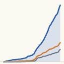
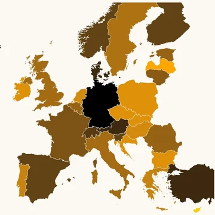
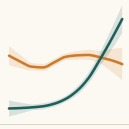

A central component of my research is the development of new data resources that facilitate the systematic study of government policies, public opinion and political outcomes. This page provides access to the datasets, codebooks, and related documentation produced through these projects for scholars, policymakers, and interested members of the public.

## Policy datasets

::: {.agenda-row .data-entry}
<i class="bi bi-cash-coin"></i>

::: {.agenda-body}
### UN Refugee Agencies Funding (URAF) Dataset {#uraf}

Rausis, F., Bachelet, M., & <strong>Lutz, P.</strong> (2026)

The URAF dataset records the financial contributions of all 193 UN member states and the European Union to the UN refugee agencies UNHCR and UNRWA from 1990 to 2025. The data allow systematic cross-national comparisons of how states fund the two agencies.

<dl class="proj-meta">
<dt>Coverage</dt><dd>193 UN member states and the European Union, 1990–2025</dd>
<dt>Files</dt><dd>CSV, Excel, codebook (PDF)</dd>
<dt>Version</dt><dd>1.0</dd>
<dt>Licence</dt><dd><a href="https://creativecommons.org/licenses/by/4.0/">CC BY 4.0</a></dd>
<dt>DOI</dt><dd><a href="https://doi.org/10.5281/zenodo.17983862">10.5281/zenodo.17983862</a></dd>
</dl>

::: {.data-links}
[Data (csv)](https://zenodo.org/records/17983862/files/URAF_1.0_data.csv?download=1){.pub-btn} · [Codebook](https://zenodo.org/records/17983862/files/URAF_1.0_codebook.pdf?download=1){.pub-btn}
:::

<pre class="bibtex" hidden>@misc{Rausis2026URAF,
  author = {Rausis, Frowin and Bachelet, Maud and Lutz, Philipp},
  title = {The {UN} Refugee Agencies Funding ({URAF}) Dataset},
  year = {2026},
  version = {1.0},
  publisher = {Zenodo},
  doi = {10.5281/zenodo.17983862},
  url = {https://doi.org/10.5281/zenodo.17983862},
  note = {Dataset, version 1.0}
}</pre>

Publications using the data (1)

- Rausis, F., Bachelet, M., & **Lutz, P.** (2024) [UN refugee agencies: Vulnerable funding structures and a looming legitimacy crisis](https://www.fmreview.org/financing-displacement-response/rausis-bachelet-lutz/). *Forced Migration Review*, 74.

:::
:::

::: {.agenda-row .data-entry}

::: {.agenda-body}
### Migration Provisions in Preferential Trade Agreements (MITA) Dataset {#mita}

Lavenex, S., <strong>Lutz, P.</strong>, & Hoffmeyer-Zlotnik, P. (2026)

The MITA dataset codes the migration-related content of all preferential trade agreements signed between 1960 and 2024 whose text is publicly available. Provisions on mobility, migrant rights and migration control are coded across main texts, annexes and side letters.

<dl class="proj-meta">
<dt>Coverage</dt><dd>Preferential trade agreements signed worldwide, 1960–2024</dd>
<dt>Files</dt><dd>Stata (.dta), codebook (PDF)</dd>
<dt>Version</dt><dd>2</dd>
<dt>Licence</dt><dd><a href="https://creativecommons.org/licenses/by/4.0/">CC BY 4.0</a></dd>
<dt>DOI</dt><dd><a href="https://doi.org/10.5281/zenodo.20692494">10.5281/zenodo.20692494</a></dd>
</dl>

::: {.data-links}
[Data (dta)](https://zenodo.org/records/20692494/files/Migration_Provisions_in_Preferential_Trade_Agreements_Dataset_v2.dta?download=1){.pub-btn} · [Codebook](https://zenodo.org/records/20692494/files/codebook_v2.pdf?download=1){.pub-btn} · [Dataset article](https://doi.org/10.1007/s11558-023-09493-5){.pub-btn}
:::

<pre class="bibtex" hidden>@misc{Lavenex2026MITA,
  author = {Lavenex, Sandra and Lutz, Philipp and Hoffmeyer-Zlotnik, Paula},
  title = {Migration Provisions in Preferential Trade Agreements ({MITA}) Dataset},
  year = {2026},
  version = {2},
  publisher = {Zenodo},
  doi = {10.5281/zenodo.20692494},
  url = {https://doi.org/10.5281/zenodo.20692494},
  note = {Dataset, version 2}
}</pre>

Publications using the data (7)

- **Lutz, P.**, Lavenex, S., & Hoffmeyer-Zlotnik, P. (2026) [Trading migration? Explaining mobility provisions in preferential trade agreements](https://doi.org/10.1007/s11558-026-09654-2). *The Review of International Organizations*, FirstView.
- Alvarado, M., Hoffmeyer-Zlotnik, P., Lavenex, S., & **Lutz, P.** (2025) [Business migration between labour and trade: Evidence from Switzerland](https://doi.org/10.1186/s40878-025-00483-7). *Comparative Migration Studies*, 13: 60.
- Lavenex, S., Alvarado, M., Hoffmeyer-Zlotnik, P., & **Lutz, P.** (2025) [Business mobility as a privileged form of temporary labour migration: Insights from the MITA database and Switzerland](publications/ilo_chapter.pdf). In: Temporary labour migration: Towards social justice?, edited by Christiane Kuptsch and Fabiola Mieres. Geneva: International Labour Organisation, pp.107-128.
- Lavenex, S., **Lutz, P.**, & Hoffmeyer-Zlotnik, P. (2024) [Migration governance through trade agreements: Insights from the MITA dataset](https://doi.org/10.1007/s11558-023-09493-5). *Review of International Organizations*, 19: 147–173.
- Hoffmeyer-Zlotnik, P., Lavenex, S., & **Lutz, P.** (2024) [The limits of EU market power in migration externalization: Explaining migration control provisions in EU preferential trade agreements](https://doi.org/10.1111/jcms.13563). *Journal of Common Market Studies*, 62(5): 1351–1378.
- Hoffmeyer-Zlotnik, P., Lavenex, S., & **Lutz, P.** (2024) [Migration governance through trade agreements: A two-level analysis](publications/mita_twolevel.pdf). In W. Sievers, R. Bauböck, M. Czaika, & A. Kraler (Eds.), *Drawing boundaries and crossing borders: Migration in Theorie und Praxis. Jahrbuch Migrationsforschung 7*. Vienna: Verlag der Österreichischen Akademie der Wissenschaften, pp. 169–184.
- Lavenex, S., Hoffmeyer-Zlotnik, P., & **Lutz, P.** (2023) [Expanding, complementing, or substituting multilateralism? EU preferential trade agreements in the migration regime complex](https://doi.org/10.17645/pag.v11i2.6341). *Politics and Governance*, 11(2): 49–61.

<i class="bi bi-bar-chart-line app-icon" aria-hidden="true"></i>

The MITA Explorer

Interactive dashboard to explore the MITA dataset.

<a class="app-open" href="https://philipplutz.shinyapps.io/MITA/" target="_blank" rel="noopener"><i class="bi bi-box-arrow-up-right"></i>Open the app</a><button type="button" class="app-load" data-src="https://philipplutz.shinyapps.io/MITA/" data-title="The MITA Explorer" data-h="1100"><i class="bi bi-window"></i>Load it here</button>

:::
:::

::: {.agenda-row .data-entry}

::: {.agenda-body}
### Refugee Dispersal Policy (RDP) Dataset {#rdp}

Bartl, W., & <strong>Lutz, P.</strong> (2025)

The RDP dataset codes how 32 European countries allocate asylum seekers across their territory, based on their dispersal policies in 2020. The coded measures capture the varieties of responsibility-sharing for asylum seekers within European countries.

<dl class="proj-meta">
<dt>Coverage</dt><dd>32 European countries, 2020</dd>
<dt>Files</dt><dd>CSV, technical report (PDF), replication code</dd>
<dt>Licence</dt><dd><a href="https://creativecommons.org/licenses/by/4.0/">CC BY 4.0</a></dd>
<dt>DOI</dt><dd><a href="https://doi.org/10.25673/1914118-10">10.25673/1914118-10</a></dd>
</dl>

::: {.data-links}
[Data (csv)](https://sadar.uni-halle.de/bitstream/1914118/19/1/RDP_dataset.csv){.pub-btn} · [Technical report](https://sadar.uni-halle.de/bitstream/1914118/19/2/technical_report.pdf){.pub-btn} · [Dataset article](https://doi.org/10.1111/gove.70072){.pub-btn}
:::

<pre class="bibtex" hidden>@misc{Bartl2025RDP,
  author = {Bartl, Walter and Lutz, Philipp},
  title = {Refugee Dispersal Policy ({RDP}) Data Set},
  year = {2025},
  doi = {10.25673/1914118-10},
  url = {https://doi.org/10.25673/1914118-10},
  note = {Dataset}
}</pre>

Publications using the data (1)

- Bartl, W. & **Lutz, P.** (2025) [Comparing refugee dispersal policies: Varieties of responsibility-sharing in Europe](https://doi.org/10.1111/gove.70072). *Governance*, 38(4): e70072.

:::
:::

::: {.agenda-row .data-entry}

::: {.agenda-body}
### RESET-OECD Dataset {#reset}

<strong>Lutz, P.</strong>, & Portmann, L. (2021)

The RESET-OECD dataset provides quantitative indicators of the refugee resettlement policies of OECD countries from 1980 to 2019. The indicators trace over four decades how these countries admit refugees from countries of first asylum.

<dl class="proj-meta">
<dt>Coverage</dt><dd>OECD countries, 1980–2019</dd>
<dt>Files</dt><dd>Stata (.dta), codebook (PDF)</dd>
<dt>Version</dt><dd>1</dd>
<dt>DOI</dt><dd><a href="https://doi.org/10.5281/zenodo.5762158">10.5281/zenodo.5762158</a></dd>
</dl>

::: {.data-links}
[Data (dta)](https://zenodo.org/records/5762158/files/RESET_OECD.dta?download=1){.pub-btn} · [Codebook](https://zenodo.org/records/5762158/files/codebook_RESET_OECD.pdf?download=1){.pub-btn} · [Dataset article](https://doi.org/10.1080/1369183X.2021.1999222){.pub-btn}
:::

<pre class="bibtex" hidden>@misc{Lutz2021RESETOECD,
  author = {Lutz, Philipp and Portmann, Lea},
  title = {{RESET-OECD} dataset},
  year = {2021},
  version = {1},
  publisher = {Zenodo},
  doi = {10.5281/zenodo.5762158},
  url = {https://doi.org/10.5281/zenodo.5762158},
  note = {Dataset, version 1}
}</pre>

Publications using the data (1)

- **Lutz, P.** & Portmann, L. (2022) [Why do states admit refugees? A comparative analysis of resettlement policies in OECD countries](https://doi.org/10.1080/1369183X.2021.1999222). *Journal of Ethnic and Migration Studies*, 48(11): 2515–2539.

:::
:::

::: {.agenda-row .data-entry}

::: {.agenda-body}
### DEMIG Policy Government Extension {#demig-government}

<strong>Lutz, P.</strong>

The DEMIG Policy Government Extension assigns each migration policy change recorded in the DEMIG Policy dataset to the cabinet in charge, covering 18 West European countries from 1980 to 2014. The data allow analyses of how governments shape migration policy output.

<dl class="proj-meta">
<dt>Coverage</dt><dd>18 West European countries, 1980–2014</dd>
<dt>Source data</dt><dd>DEMIG Policy dataset (De Haas et al. 2015)</dd>
<dt>Access</dt><dd>Available upon request</dd>
</dl>

::: {.data-links}
[Request the data](mailto:p.lutz@vu.nl?subject=DEMIG%20Policy%20Government%20Extension){.pub-btn}
:::

Publications using the data (3)

- **Lutz, P.** (2019) [Variation in policy success: Radical right populism and migration policy](https://doi.org/10.1080/01402382.2018.1504509). *West European Politics*, 42(3): 517–544.
- **Lutz, P.** (2021) [Reassessing the gap-hypothesis: Tough talk and weak action in migration policy?](https://doi.org/10.1177/1354068819840776). *Party Politics*, 27(1): 174–186.
- **Lutz, P.** (2019) [The Radical-Right in Power: A Comparative Analysis Of Their Migration Policy Influence](publications/RRPP2019.pdf). In: Biard, Benjamin/Bernhard, Laurent/Betz, Hans-Georg (Hrsg.): Do they make a difference? The policy influence of radical right populist parties in Western Europe. ECPR-Press.

:::
:::

## Survey data

::: {.agenda-row .data-entry}

::: {.agenda-body}
### Immigration misperceptions module, MOSAiCH 2023 {#mosaich-2023}

<strong>Lutz, P.</strong>, & Bitschnau, M. (2023)

Our module in MOSAiCH 2023, the biennial population survey of social attitudes in Switzerland run by FORS, measures misperceptions about immigration. The items measure misperceptions beyond innumeracy and distinguish them from guessing.

<dl class="proj-meta">
<dt>Survey</dt><dd>MOSAiCH 2023, population of Switzerland, push-to-web mixed mode in German, French and Italian</dd>
<dt>Access</dt><dd>FORS data service (SWISSUbase)</dd>
</dl>

::: {.data-links}
[Data (SWISSUbase)](https://www.swissubase.ch/en/catalogue/studies/20527/latest){.pub-btn} · [DOI](https://doi.org/10.48573/ae9w-0w40){.pub-btn}
:::

Publications using the data (1)

- **Lutz, P.** & Bitschnau, M. (2026) [Beyond innumeracy: Measuring public misperceptions about immigration](https://doi.org/10.1017/psrm.2025.10055). *Political Science Research and Methods*, 14(4), 1326-1343.

:::
:::

::: {.agenda-row .data-entry}

::: {.agenda-body}
### Mass immigration initiative questionnaire, MOSAiCH 2017 {#mosaich-2017}

Armingeon, K., & <strong>Lutz, P.</strong> (2017)

Our questionnaire in MOSAiCH 2017, the biennial population survey of social attitudes in Switzerland run by FORS, covers citizens' responses to the implementation of the initiative on mass immigration. The items include trade-off preferences, party cues and values.

<dl class="proj-meta">
<dt>Survey</dt><dd>MOSAiCH 2017, representative sample of the population of Switzerland</dd>
<dt>Access</dt><dd>FORS data service (SWISSUbase)</dd>
</dl>

::: {.data-links}
[Data (SWISSUbase)](https://www.swissubase.ch/en/catalogue/studies/13087/latest){.pub-btn}
:::

Publications using the data (2)

- Armingeon, K. & **Lutz, P.** (2023) [Citizens' response to a non-responsive government: The case of the Swiss initiative on mass immigration](https://doi.org/10.1057/s41295-022-00306-4). *Comparative European Politics*, 21: 133–151.
- Armingeon, K. & **Lutz, P.** (2020) [Muddling between responsiveness and responsibility: The Swiss case of a non-implementation of a constitutional rule](https://doi.org/10.1057/s41295-019-00185-2). *Comparative European Politics*, 18: 256–280.

:::
:::

::: {.agenda-row .data-entry}
<i class="bi bi-people"></i>

::: {.agenda-body}
### Business migration items, Migration-Mobility Survey {#mms}

Lavenex, S., Hoffmeyer-Zlotnik, P., & <strong>Lutz, P.</strong>

<!-- GAP: survey wave(s) with our items; add the year to the byline once known -->

Our items on business migration are part of the Migration-Mobility Survey, the nccr – on the move survey of migrants in Switzerland conducted in biennial waves since 2016. The survey also covers migration trajectories, family composition, labour market participation and integration.

<dl class="proj-meta">
<dt>Survey</dt><dd>Migration-Mobility Survey, migrants living in Switzerland, biennial waves since 2016</dd>
<dt>Access</dt><dd>nccr – on the move (SWISSUbase), conditions apply</dd>
</dl>

::: {.data-links}
[Data (SWISSUbase)](https://www.swissubase.ch/en/catalogue/studies/12851/latest){.pub-btn}
:::

Publications using the data (2)

- Alvarado, M., Hoffmeyer-Zlotnik, P., Lavenex, S., & **Lutz, P.** (2025) [Business migration between labour and trade: Evidence from Switzerland](https://doi.org/10.1186/s40878-025-00483-7). *Comparative Migration Studies*, 13: 60.
- Lavenex, S., Alvarado, M., Hoffmeyer-Zlotnik, P., & **Lutz, P.** (2025) [Business mobility as a privileged form of temporary labour migration: Insights from the MITA database and Switzerland](publications/ilo_chapter.pdf). In: Temporary labour migration: Towards social justice?, edited by Christiane Kuptsch and Fabiola Mieres. Geneva: International Labour Organisation, pp.107-128.

:::
:::

## Replication files {#replication}

Replication packages for 11 publications. Each publication with its abstract is listed on the [publications page](publications.html).

::: {.replication-list}
- **Lutz, P.**, Lavenex, S., & Hoffmeyer-Zlotnik, P. (2026) Trading migration? Explaining mobility provisions in preferential trade agreements. *The Review of International Organizations*, FirstView. [Replication files](https://zenodo.org/records/22900298){.pub-btn}
- **Lutz, P.**, & Crum, B. (2026) Fair enough? Citizens’ preferences on refugee distribution in the EU. *European Journal of Political Research*, FirstView. [Replication files](publications/Lutz_Crum_EJPR_replication_files.zip){.pub-btn}
- **Lutz, P.**, & Does, S. (2026) Seeing Divides: Citizens’ Biased Perceptions of Political Cleavages. *Political Behavior*, OnlineFirst. [Replication files](https://doi.org/10.7910/DVN/WIMUVL){.pub-btn}
- **Lutz, P.**, Trauner, F., & Stutz, P. (2026) Towards more fairness among states: How Dublin transfers redistribute asylum responsibility. *European Union Politics*, FirstView. [Replication files](EUP_replication_files.zip){.pub-btn}
- **Lutz, P.** & Bachelet, M. (2026) Europe's immigration divide: multidimensional responsibility-sharing as a solution? *Journal of European Public Policy*, FirstView. [Replication files](lutz_bachelet2026_replication.zip){.pub-btn}
- Manser-Egli, S. & **Lutz, P.** (2026) Integration for whom? The migration bias in social norms. *European Societies*, 28(3): 569–588. [Replication files](lutz_manseregli_replication.zip){.pub-btn}
- **Lutz, P.** & Bitschnau, M. (2026) Beyond innumeracy: Measuring public misperceptions about immigration. *Political Science Research and Methods*, 14(4), 1326-1343. [Replication files](https://dataverse.harvard.edu/citation?persistentId=doi:10.7910/DVN/EPX9VY){.pub-btn}
- **Lutz, P.** (2025) Do immigrants at bay keep the xenophobes away? Post-entry rights and public opposition to immigrant admission. *European Political Science Review*, 17(1): 128–142. [Replication files](replication_files_EPSR_LUTZ2025.zip){.pub-btn}
- **Lutz, P.** (2024) Between common responsibility and national interest: When do Europeans support a common European migration policy? *European Union Politics*, 25(2): 313–332. [Replication files](Lutz2024_replication.zip){.pub-btn}
- Lavenex, S., **Lutz, P.**, & Hoffmeyer-Zlotnik, P. (2024) Migration governance through trade agreements: Insights from the MITA dataset. *Review of International Organizations*, 19: 147–173. [Replication files](https://static-content.springer.com/esm/art%3A10.1007%2Fs11558-023-09493-5/MediaObjects/11558_2023_9493_MOESM2_ESM.zip){.pub-btn}
- Schultz, C., **Lutz, P.**, & Simon, S. (2021) Explaining the immigration policy mix: Countries’ relative openness to asylum and labour migration. *European Journal of Political Research*, 60(4): 763–784. [Replication files](Schultz2021_replication.zip){.pub-btn}
:::
