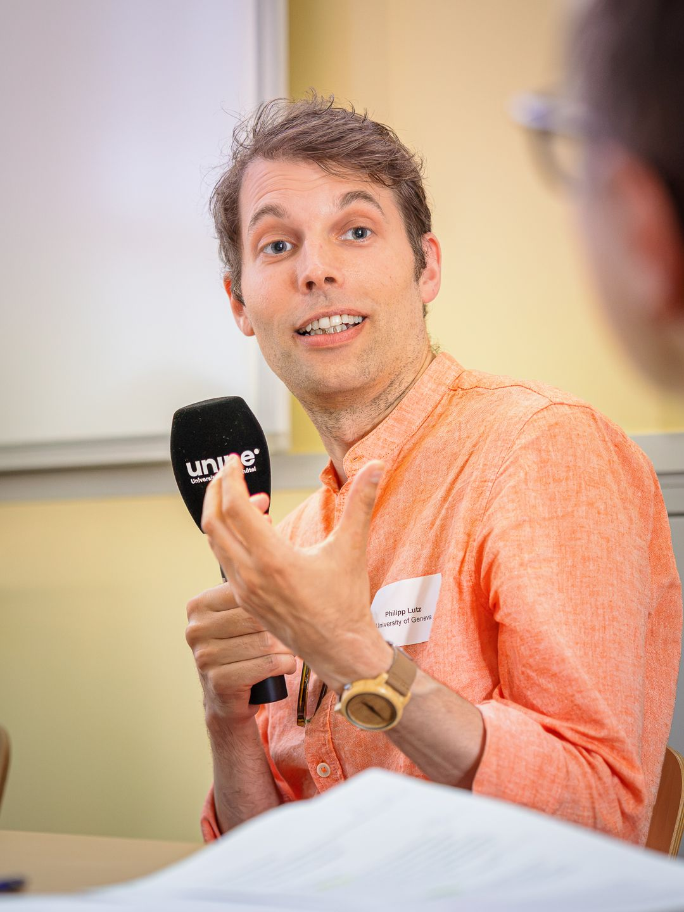

{.column-margin .engagement-photo fig-alt="Public panel at University of Neuchatel"}

Immigration has become a key issue of political contestation in Europe. I bring the findings of my research into policy-making and public debate: through policy papers for think tanks and public institutions, public events, short articles in English, German, French and Dutch, and media commentary.

For media requests, public talks, or advisory work, please [email me](mailto:p.lutz@vu.nl).

[Download portrait photo (high resolution)](prof_pic.jpg){.pub-btn download="prof_pic.jpg"} *Photo: Peter Gerritsen.*

## Policy papers

- Trauner, F., **Lutz, P.**, & Stutz, P. (November 2025) [*Towards a fairer EU asylum policy: Lessons from the Dublin system for the EU's Solidarity Mechanism*](https://www.epc.eu/publication/towards-a-fairer-eu-asylum-policy-lessons-from-the-dublin-system-for-the-eus-solidarity-mechanism/). Discussion Paper. Brussels: European Policy Centre.
Lessons from the Dublin system for the EU's new solidarity mechanism: make fairness a transparent criterion for responsibility transfers and prioritise transfers from more to less pressured member states.

- Bachelet, M. & **Lutz, P.** (August 2025) [*Europe's divide on immigration: Making responsibility-sharing work*](https://nccr-onthemove.ch/wp_live14/wp-content/uploads/2025/08/Policy-Brief-nccr-on-the-move-26-EN-Web2pdf.pdf). Policy Brief in a Nutshell 26. Neuchâtel: nccr – on the move. Also available in [French](https://nccr-onthemove.ch/wp_live14/wp-content/uploads/2025/08/Policy-Brief-nccr-on-the-move-26-FR-Web.pdf) and [German](https://nccr-onthemove.ch/wp_live14/wp-content/uploads/2025/08/Policy-Brief-nccr-on-the-move-26-DE-Web.pdf).
Responsibility-sharing in Europe needs binding and transparent fairness rules with enforcement, combined with flexibility for states to contribute in different ways, such as financial or operational support.

- Herrmann, M., Zogg, P., & **Lutz, P.** (February 2025) [*Analyse des Algorithmus und seiner Nutzung zur Verteilung der Asylsuchenden auf die Kantone*](https://www.parlament.ch/centers/documents/_layouts/15/DocIdRedir.aspx?ID=DOCID-1-12618). Report for the Swiss Parliamentary Administrative Control. Ostermundigen: PrivatePublicConsulting. [In German]
An assessment of the algorithm the State Secretariat for Migration uses to allocate asylum seekers to cantons: the algorithm covers most legal criteria, yet actual allocations often deviate from its targets and rely heavily on manual corrections.

- **Lutz, P.**, Solenthaler, N., & Sutter, N. (October 2020) [*Die Zirkulär-Bewilligung: Das brachliegende Potenzial der Drittstaatenmigration*](https://www.foraus.ch/publications/die-zirkulaer-bewilligung/). foraus policy brief. Zurich. [In German]
A proposal for a circular permit that makes the residence status of third-country migrants more flexible, so that Switzerland, migrants and their countries of origin can use the development potential of circular migration.

- Brantschen, S., **Lutz, P.**, Portmann, L., Faoro, N., & Wäspi, F. (February 2019) [*Swiss Refugee Partnership: Eine neue Zulassungspolitik im Schweizer Asylwesen*](https://www.foraus.ch/wp-content/uploads/2019/02/foraus_Swiss-Refugee-Partnership.pdf). foraus Discussion Paper No. 38. Zurich/Geneva. [Summary in [AsylNews](https://t.co/PZ0jPkqgsT?amp=1), No. 3, September 2019]
A proposal for a new admission model in which private persons and civil society contribute on their own initiative to refugee protection, making Switzerland's resettlement policy more institutionalised and flexible.

- **Lutz, P.**, Kaufmann, D., Stünzi, A., & Egli, S. (2017) [*Prisoners of the Dublin Dilemma: How to reform the Common European Asylum System?*](https://www.foraus.ch/wp-content/uploads/2017/08/foraus-Dublin_ENG.pdf) foraus Discussion Paper No. 32. Zurich/Geneva.
The Dublin rules give frontline states and asylum seekers incentives to circumvent them; the paper proposes separating registration from processing, considering applicants' preferred destinations and sharing costs through a distribution key with financial compensation.
[German version: Gefangen im Dublin-Dilemma](https://www.foraus.ch/wp-content/uploads/2016/12/foraus_Diskussionspapier-Dublin.pdf){.pub-btn} · [Op-ed (NZZ)](publications/nzz_oped_dublin.pdf){.pub-btn}

- Kaufmann, D. & **Lutz, P.** (February 2015) [*Gefangen im Nullsummenspiel: Eine Bewertung der MEI-Umsetzungsvorschläge*](https://www.foraus.ch/wp-content/uploads/2015/02/foraus-Gefangen-Im-Nullsummenspiel.pdf). foraus Discussion Paper No. 23. Zurich/Geneva. [In German]
An assessment of four ways to implement the mass immigration initiative: quotas and domestic priority raise costs for firms, migrants and the state, so lawmakers must decide which of the initiative's conflicting goals to prioritise.

## Public events

### Medien-Dialog Migration: Der EU-Migrations- und Asylpakt: Was die Reform bezweckt, wie sie umgesetzt wird und was sich konkret verändert

<i class="bi bi-play-btn app-icon" aria-hidden="true"></i>

German edition, 20 August 2025

Mit <strong>Philipp Lutz</strong>, Adriana Romer und Maud Bachelet, moderiert von Natalie Avanzino.

<a class="app-open" href="https://www.youtube.com/watch?v=2OLIoficTyU&t=1674s" target="_blank" rel="noopener"><i class="bi bi-box-arrow-up-right"></i>Watch on YouTube</a><button type="button" class="app-load" data-src="https://www.youtube-nocookie.com/embed/2OLIoficTyU?start=1674" data-title="Medien-Dialog Migration, 20 August 2025" data-ratio="16 / 9"><i class="bi bi-window"></i>Play here</button>

<i class="bi bi-play-btn app-icon" aria-hidden="true"></i>

French edition, 23 May 2024

Avec <strong>Philipp Lutz</strong>, Maud Bachelet et Simon Noori.

<a class="app-open" href="https://www.youtube.com/watch?v=5fVJmVN69Qo" target="_blank" rel="noopener"><i class="bi bi-box-arrow-up-right"></i>Watch on YouTube</a><button type="button" class="app-load" data-src="https://www.youtube-nocookie.com/embed/5fVJmVN69Qo" data-title="Medien-Dialog Migration, French edition, 23 May 2024" data-ratio="16 / 9"><i class="bi bi-window"></i>Play here</button>

### Abstimmungsdebatte (27.08.2020): Zahlen und Analysen über aktuelle Migrationsbewegungen in und aus der Schweiz 

Podiumsdiskussion mit Jonathan Zufferey, Sarah Progin-Theuerkauf, Ensar Can, **Philipp Lutz**, moderiert von Simone Prodolliet.

<i class="bi bi-play-btn app-icon" aria-hidden="true"></i>

<a class="app-open" href="https://www.youtube.com/watch?v=Z-h9GWsWPJs" target="_blank" rel="noopener"><i class="bi bi-box-arrow-up-right"></i>Watch on YouTube</a><button type="button" class="app-load" data-src="https://www.youtube-nocookie.com/embed/Z-h9GWsWPJs" data-title="Abstimmungsdebatte, 27 August 2020" data-ratio="16 / 9"><i class="bi bi-window"></i>Play here</button>

## Short articles & blog posts

- **Lutz, P.**, & Bachelet, M. (2026) [*Soll sich die Schweiz am EU-Solidaritätsmechanismus in der Asylpolitik beteiligen?*](https://www.defacto.expert/2026/05/18/soll-sich-die-schweiz-am-eu-solidaritaetsmechanismus-in-der-asylpolitik-beteiligen/) *DeFacto*, 18 May. [In German; also in [French](https://www.defacto.expert/2026/05/18/la-suisse-doit-elle-participer-au-mecanisme-de-solidarite-du-pacte-de-lue-sur-la-migration-et-lasile/?lang=fr)]
- **Lutz, P.**, Trauner, F., & Stutz, P. (2026) [*The EU's Dublin system is widely seen as unfair – but official statistics tell a different story*](https://blogs.lse.ac.uk/europpblog/2026/05/15/eu-dublin-system-asylum-fairness-statistics/). *LSE EUROPP blog*, 15 May.
- **Lutz, P.**, & Bachelet, M. (2026) [*The new pact on migration and asylum: Political developments and implications for European responsibility-sharing*](https://asyl.recht.ch/de/artikel/02asyl0126abh/new-pact-migration-and-asylum-political-developments-and-implications). *ASYL*, 01/2026: 8–14. [PDF](publications/lutz_bachelet_asyl.pdf){.pub-btn}
- **Lutz, P.**, & Bitschnau, M. (2026) [*Why we need to rethink what we know about public views on immigration*](https://theloop.ecpr.eu/why-we-need-to-rethink-what-we-know-about-public-views-on-immigration/). *The Loop* (ECPR), 20 January.
- Manser-Egli, S., & **Lutz, P.** (2025) [*Integration dispensation: Why immigrants face stronger social norms*](https://nccr-onthemove.ch/blog/integration-dispensation-why-immigrants-face-stronger-social-norms/). *nccr – on the move blog*, 3 November. Reposted on *DeFacto*.
- Manser-Egli, S., & **Lutz, P.** (2025) [*Voor immigranten gelden strengere sociale normen*](https://www.socialevraagstukken.nl/migratiesamenleving/voor-immigranten-gelden-strengere-sociale-normen/). *Sociale Vraagstukken*. [In Dutch]
- **Lutz, P.** (2025) [*Niederlassung statt Mobilität: Der Fehlanreiz restriktiver Einwanderungspolitik*](https://issuu.com/pomona.media/docs/terra_cognita_41_bf?fr=xKAE9_zU1NQ). *Terra cognita*, 41. [In German]
- Rausis, F., Bachelet, M., & **Lutz, P.** (2024) [*UN refugee agencies: Vulnerable funding structures and a looming legitimacy crisis*](https://www.fmreview.org/financing-displacement-response/rausis-bachelet-lutz/). *Forced Migration Review*, 74.
- Bachelet, M., Rausis, F., & **Lutz, P.** (2024) [*Defunding UNRWA: What is at stake?*](https://www.defacto.expert/2024/12/02/defunding-unrwa-what-is-at-stake/?lang=en) *DeFacto*, 2 December. [In English, French and German]
- **Lutz, P.**, & Lavenex, S. (2024) [*Switzerland comes to terms with being a country of immigration*](https://www.migrationpolicy.org/article/switzerland-immigration-politics-policy). *Migration Information Source* (Migration Policy Institute), 18 September.
- **Lutz, P.** (2024) [*The politics of free movement: What have we learned?*](https://nccr-onthemove.ch/blog/the-politics-of-free-movement-what-have-we-learned/) *nccr – on the move blog*.
- Bachelet, M., & **Lutz, P.** (2024) [*A new pact on migration and asylum: What changes for responsibility-sharing in the European Union?*](https://nccr-onthemove.ch/blog/a-new-pact-on-migration-and-asylum-what-changes-for-responsibility-sharing-in-the-european-union/) *nccr – on the move blog*, 28 February.
- Lavenex, S., Hoffmeyer-Zlotnik, P., & **Lutz, P.** (2023) [*What do trade agreements have to do with migration policy?*](https://migrationpolicycentre.eu/what-do-trade-agreements-have-to-do-with-migration-policy/) *Migration Policy Centre blog* (European University Institute).

Earlier pieces (2017–2022)

- **Lutz, P.**, & Bitschnau, M. (2022) [*Misperceptions drive immigration politics and undermine democracy*](https://theloop.ecpr.eu/misperceptions-drive-immigration-politics-and-undermine-democracy/). *The Loop* (ECPR).
- **Lutz, P.** (2021) [*How the 2015 migration crisis shaped the bordering preferences of EU citizens*](https://blogs.lse.ac.uk/europpblog/2021/02/25/how-the-2015-migration-crisis-shaped-the-bordering-preferences-of-eu-citizens/). *LSE EUROPP blog*, 25 February.
- **Lutz, P.** (2020) [*Personenfreizügigkeit in der Krise?*](https://nccr-onthemove.ch/blog/personenfreizugigkeit-in-der-krise/) *nccr – on the move blog*, reposted on *DeFacto*. [In German]
- **Lutz, P.**, & Bitschnau, M. (2020) [*Why most people are wrong about immigration*](https://www.routedmagazine.com/omc2020-2-people-wrong-migration). *Routed Migration & (Im)mobility Magazine*.
- Stünzi, A., Kaufmann, D., **Lutz, P.**, & Manser-Egli, S. (2019) [*Wie kann die europäische Asylpolitik reformiert werden?*](https://www.terra-cognita.ch/fileadmin/user_upload/terracognita/documents/Terra_Cognita_35-19.pdf) *Terra cognita*, 35. [In German]
- **Lutz, P.**, & Manser-Egli, S. (2019) [*Schengen-Dublin als öffentliches Gut eines integrierten Europas*](https://nccr-onthemove.ch/blog/schengen-dublin-als-offentliches-gut-eines-integrierten-europas/). *nccr – on the move blog*, 17 May. [In German]
- **Lutz, P.** (2017) [*Warum Heimat nach Gestaltung statt Konservierung verlangt*](https://www.philosophie.ch/2017-06-28-lutz). *philosophie.ch*, 28 June. Reprinted as [*Heimat gestalten statt konservieren*](https://www.bwso.ch/wp-content/uploads/2026/07/BWSO-Info_2-2026-Homepage.pdf), *INFO-BWSO*, 2/2026: 4–5. [In German]
- **Lutz, P.** (2017) [*Wie Migranten Muslime wurden*](https://www.haus-der-religionen.ch/file/repository/SAGW_Bulletin_2_17_web_Einzelseiten.pdf). *Bulletin der Schweizerischen Akademie der Geistes- und Sozialwissenschaften*, 2/2017. [In German]

## Recent media

::: {#mentions-media .mentions}
:::

## Policy uptake

Policy reports and parliamentary documents that draw on my research:

::: {#mentions-policy .mentions}
:::
