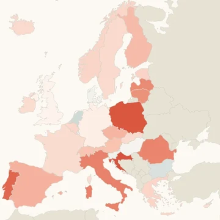
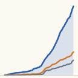

::: {.column-page}
::: {.grid .home-grid}

<!-- ===================== main column ===================== -->
::: {.g-col-12 .g-col-lg-8}

Philipp Lutz

I am a political scientist at the <a href="https://www.unige.ch/sciences-societe/speri/membres/enseignants-chercheurs/philipp-lutz">University of Geneva</a> (SNSF Ambizione Fellow) and the <a href="https://research.vu.nl/en/persons/philipp-lutz/">Vrije Universiteit Amsterdam</a> (Senior Assistant Professor).

Liberal democracies are caught between economic pressures for openness and political demands for closure. I study how they navigate this liberal paradox in the politics of immigration: what drives migration policy-making, how citizens form perceptions and attitudes on immigration and European integration, and how states cooperate to govern migration at the European and international level. My work combines original datasets, comparative analysis and survey experiments.

Through my research, teaching and public engagement, I seek to advance our understanding of contemporary challenges to liberal democracies, to equip students with critical analytical skills for a complex world, and to inform policy-making and public debate.

Feel free to [get in touch](mailto:p.lutz@vu.nl).

## Research {.home-section}

::: {.agenda-row}

::: {.agenda-body}
### Migration policy-making

How do liberal democracies balance openness and closure in their migration policies?

Migration policies decide who may enter a country and on what terms immigrants may stay. I explain why some countries are more open than others, how they combine instruments in their policy mix, and how parties and ideology shape these choices.

<i class="bi bi-journal-text"></i><a class="agenda-pubs" data-ag="policy" href="publications.html#agenda=policy">Publications</a> · <i class="bi bi-folder2-open"></i><a href="projects.html#phd">PhD project</a> · <i class="bi bi-database"></i><a href="data.html#policy-datasets">Policy datasets</a>

:::
:::

::: {.agenda-row}

::: {.agenda-body}
### Public opinion and perceptions

What do citizens want and believe about immigration, and why does it matter for democracy?

Public opinion on immigration rests on preferences shaped by conflicting pressures and on perceptions that often diverge from reality. I study how citizens form these attitudes and perceptions on immigration and European integration, including how they perceive each other's views.

<i class="bi bi-journal-text"></i><a class="agenda-pubs" data-ag="opinion" href="publications.html#agenda=opinion">Publications</a> · <i class="bi bi-folder2-open"></i><a href="projects.html#nwo">NWO project</a> · <i class="bi bi-database"></i><a href="data.html#mosaich-2023">Survey data</a>

:::
:::

::: {.agenda-row}

::: {.agenda-body}
### European migration governance

How can European states cooperate on migration in ways that are effective and fair?

Open borders within Europe and exposure to external immigration require collective governance. I study how the EU combines internal free movement with external border control and how states share responsibility for refugee protection under functional interdependence and domestic contestation.

<i class="bi bi-journal-text"></i><a class="agenda-pubs" data-ag="sharing" href="publications.html#agenda=sharing">Publications</a> · <i class="bi bi-folder2-open"></i><a href="projects.html#ambizione">Ambizione project</a> · <i class="bi bi-bar-chart-line"></i><a href="projects.html#dublin-explorer">Dublin Explorer</a>

:::
:::

::: {.agenda-row}

::: {.agenda-body}
### Migration in trade agreements

Why do states govern migration through trade agreements?

States struggle to cooperate on migration at the multilateral level, yet they increasingly include migration provisions in trade agreements to facilitate mobility, control migration or protect migrant rights. I map these provisions, explain why states adopt them and study their role in broader migration governance.

<i class="bi bi-journal-text"></i><a class="agenda-pubs" data-ag="trade" href="publications.html#agenda=trade">Publications</a> · <i class="bi bi-folder2-open"></i><a href="projects.html#trade-mobilities">nccr project</a> · <i class="bi bi-bar-chart-line"></i><a href="https://philipplutz.shinyapps.io/MITA/">MITA Explorer</a>

:::
:::

## Teaching {.home-section}

I teach comparative and European politics, research design and migration policy at BA, MA and PhD level, in English, French and German, and I am happy to supervise theses on the politics of migration, public opinion and European integration.

<i class="bi bi-easel"></i><a href="teaching.html">Courses</a> · <i class="bi bi-mortarboard"></i><a href="teaching.html#theses">Thesis supervision</a>

## Public engagement {.home-section}

My research engages with public and policy debates on migration, asylum and European integration through public talks, think-tank work, policy advocacy and media commentary.

<i class="bi bi-file-earmark-text"></i><a href="engagement.html#policy-papers">Policy papers</a> · <i class="bi bi-bank"></i><a href="engagement.html#policy-uptake">Policy uptake</a> · <i class="bi bi-newspaper"></i><a href="engagement.html#recent-media">Media</a>

:::

<!-- ===================== side column ===================== -->
::: {.g-col-12 .g-col-lg-4 .home-side}

{.home-portrait fig-alt="Portrait of Philipp Lutz"}

::: {.side-block}
#### Upcoming

1–2 Feb 2027
Annual Conference of the Swiss Political Science Association 
University of Lucerne (CH)

:::

::: {.side-block}
#### News

[All news →](news.qmd)

:::

::: {.side-block .side-contact}
#### Contact

Vrije Universiteit Amsterdam 
Department of Political Science and Public Administration De Boelelaan 1105, 1081 HV Amsterdam 
<a href="mailto:p.lutz@vu.nl">p.lutz@vu.nl</a>

University of Geneva 
Department of Political Science and International Relations Boulevard du Pont d'Arve 40, 1205 Geneva 
<a href="mailto:philipp.lutz@unige.ch">philipp.lutz@unige.ch</a>

:::

:::

:::
:::
