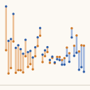
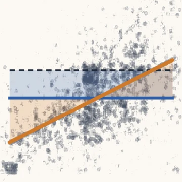

::: {.column-page}
::: {.grid .home-grid}

<!-- ===================== main column ===================== -->
::: {.g-col-12 .g-col-lg-8}

Philipp Lutz

I am a political scientist at the <a href="https://www.unige.ch/sciences-societe/speri/membres/enseignants-chercheurs/philipp-lutz">University of Geneva</a> (SNSF Ambizione Fellow) and the <a href="https://research.vu.nl/en/persons/philipp-lutz/">Vrije Universiteit Amsterdam</a> (Senior Assistant Professor).

Liberal democracies are caught between economic pressures for openness and political demands for closure. I study how they navigate this liberal paradox in the politics of immigration: what drives migration policy-making, how citizens form perceptions and attitudes on immigration and European integration, and how states cooperate to govern migration at the European and international level. My work combines original datasets, comparative analysis and survey experiments.

Through my research, teaching and public engagement, I seek to advance our understanding of contemporary challenges to liberal democracies, to equip students with critical analytical skills for a complex world, and to inform policy-making and public debate.

Feel free to [get in touch](mailto:p.lutz@vu.nl).

## Research {.home-section}

::: {.agenda-row}

::: {.agenda-body}
### Comparative analysis of migration policies

How do liberal democracies balance openness and closure in their migration policies?

Immigration policies decide who may enter a country and on what terms immigrants may stay. I seek to explain why some countries are more open to immigration than others, how they combine different instruments in their policy mix, and how political parties and ideology shape these policies.

<i class="bi bi-journal-text"></i><a class="agenda-pubs" data-ag="policy" href="publications.html#agenda=policy">Publications</a> · <i class="bi bi-folder2-open"></i><a href="projects.html#phd">PhD project</a> · <i class="bi bi-database"></i><a href="data.html#reset">RESET-OECD data</a>

:::
:::

::: {.agenda-row}

::: {.agenda-body}
### Public opinion and perceptions

What do citizens want and believe about immigration, and why does it matter for democracy?

I study how Europeans form attitudes and policy preferences on immigration and European integration, in particular how they navigate conflicting pressures and the ambivalence these create. Public opinion also rests on perceptions that often diverge from reality: I study how accurate these perceptions are, how to measure them, and whether people who hold misperceptions are misinformed or merely uninformed. A newer line of research examines how citizens perceive each other's views, including what they believe society expects of immigrants.

<i class="bi bi-journal-text"></i><a class="agenda-pubs" data-ag="opinion" href="publications.html#agenda=opinion">Publications</a> · <i class="bi bi-folder2-open"></i><a href="projects.html#nwo">NWO project</a> · <i class="bi bi-folder2-open"></i><a href="projects.html#misperceptions">Misperceptions project</a>

:::
:::

::: {.agenda-row}

::: {.agenda-body}
### European migration governance

When and how do European states cooperate on migration?

Open borders within Europe and exposure to external immigration require collective efforts to govern migration. I study how the EU combines internal free movement with external border control, and how European states share responsibility for refugee protection under the pressures of functional interdependence and domestic political contestation. The overarching question is how Europe can organise migration cooperation that is effective and that states and citizens accept as fair.

<i class="bi bi-journal-text"></i><a class="agenda-pubs" data-ag="sharing" href="publications.html#agenda=sharing">Publications</a> · <i class="bi bi-folder2-open"></i><a href="projects.html#ambizione">Ambizione project</a> · <i class="bi bi-bar-chart-line"></i><a href="projects.html#dublin-explorer">Dublin Explorer</a> · <i class="bi bi-database"></i><a href="data.html#uraf">Datasets</a>

:::
:::

::: {.agenda-row}

::: {.agenda-body}
### Migration governance through trade agreements

Why do states govern migration through trade agreements?

Trade and migration are two facets of an increasingly interconnected world, yet the links between trade and migration policies remain little researched. States and the European Union increasingly use trade agreements to facilitate mobility, strengthen migration control or protect migrant rights. With the MITA dataset, which covers migration provisions in preferential trade agreements worldwide since 1960, I study why states include such provisions, how they combine them and how they shape national immigration regimes and the EU's external migration policy.

<i class="bi bi-journal-text"></i><a class="agenda-pubs" data-ag="trade" href="publications.html#agenda=trade">Publications</a> · <i class="bi bi-folder2-open"></i><a href="projects.html#trade-mobilities">nccr project</a> · <i class="bi bi-database"></i><a href="data.html#mita">MITA data</a> · <i class="bi bi-bar-chart-line"></i><a href="https://philipplutz.shinyapps.io/MITA/">MITA Explorer</a>

:::
:::

## Teaching {.home-section}

I teach comparative and European politics, research design and migration policy at BA, MA and PhD level, in English, French and German, and I am happy to supervise theses on the politics of migration, public opinion and European integration.

<i class="bi bi-easel"></i><a href="teaching.html">Courses</a> · <i class="bi bi-mortarboard"></i><a href="teaching.html#theses">Thesis supervision</a>

## Public engagement {.home-section}

My research engages with public and policy debates on migration, asylum and European integration through public talks, think-tank work, policy advocacy and media commentary, with features in outlets such as SRF, NZZ, Le Temps, Die Zeit and The Telegraph.

<i class="bi bi-file-earmark-text"></i><a href="engagement.html#policy-papers">Policy papers</a> · <i class="bi bi-bank"></i><a href="engagement.html#policy-uptake">Policy uptake</a> · <i class="bi bi-newspaper"></i><a href="engagement.html#recent-media">Media</a>

:::

<!-- ===================== side column ===================== -->
::: {.g-col-12 .g-col-lg-4 .home-side}

{.home-portrait fig-alt="Portrait of Philipp Lutz"}

::: {.side-block}
#### Upcoming

1–2 Feb 2027
Annual Conference of the Swiss Political Science Association 
University of Lucerne (CH)

:::

::: {.side-block}
#### Recent publications

[Trading migration? Explaining mobility provisions in preferential trade agreements](https://doi.org/10.1007/s11558-026-09654-2) 
<em>The Review of International Organizations</em>, 2026

[Fair enough? Citizens' preferences on refugee distribution in the EU](https://doi.org/10.1017/S1475676526101595) 
<em>European Journal of Political Research</em>, 2026

[Seeing divides: Citizens' biased perceptions of political cleavages](https://doi.org/10.1007/s11109-026-10181-4) 
<em>Political Behavior</em>, 2026

:::

::: {.side-block}
#### News

2 Nov 2026
Guido Priem joins my NWO project at VU Amsterdam as postdoctoral researcher.

24 Oct 2026
New article in <em>The Review of International Organizations</em> on mobility provisions in trade agreements.

14 Oct 2026
Our article on measuring misperceptions about immigration is now in print in <em>Political Science Research and Methods</em>.

[All news →](news.qmd)

:::

:::

:::
:::
