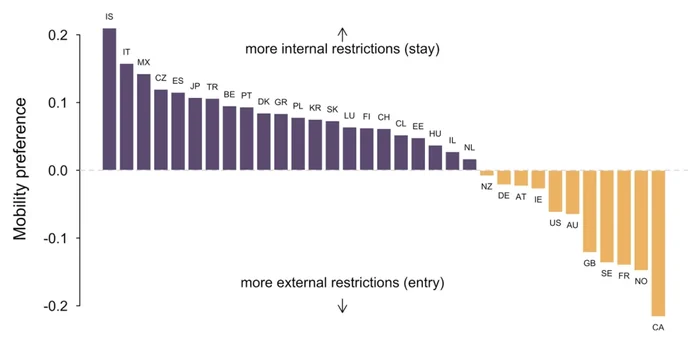
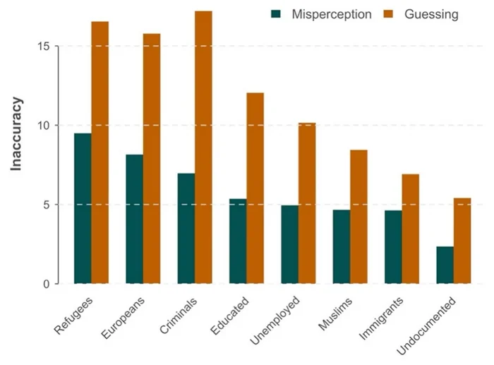
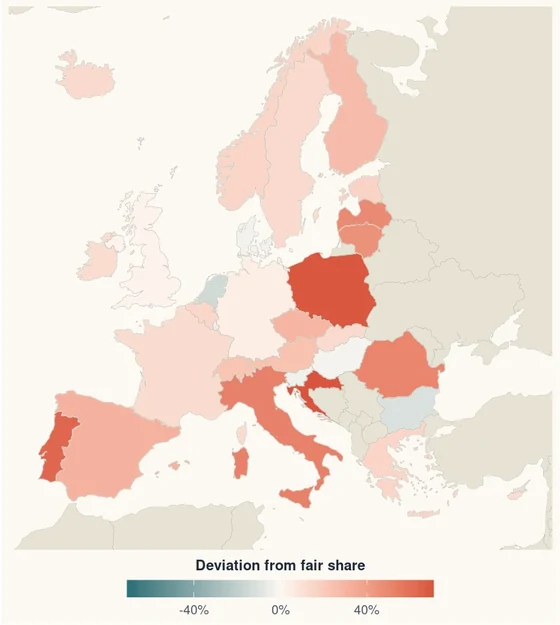
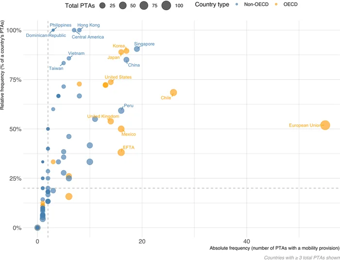

::: {.column-page}
::: {.grid .home-grid}

<!-- ===================== main column ===================== -->
::: {.g-col-12 .g-col-lg-8}

Philipp Lutz

Welcome! I'm a political scientist at the <a href="https://www.unige.ch/sciences-societe/speri/membres/enseignants-chercheurs/philipp-lutz">University of Geneva</a> (SNSF Ambizione Fellow) and the <a href="https://research.vu.nl/en/persons/philipp-lutz/">Vrije Universiteit Amsterdam</a> (Senior Assistant Professor).

I study the politics of immigration in Europe's liberal democracies, focusing on how they navigate the tension between economic pressures for openness and political demands for closure. My research examines what drives migration policy-making in comparative perspective, how citizens form perceptions and attitudes on immigration and European integration, and how states cooperate to govern migration at the European level and through trade agreements.

You'll find my [research projects](projects.qmd), including [publications](publications.qmd), [datasets](data.qmd) and [public engagement](engagement.qmd) as well as my [CV](cv.qmd) on this site.

Feel free to [get in touch](mailto:p.lutz@vu.nl).

## Research {.home-section}

### <i class="bi bi-bank"></i> Comparative analysis of migration policies

<figure class="agenda-fig"><figcaption>Lutz (2024), <em>West European Politics</em></figcaption></figure>

How do liberal democracies balance openness and closure in their migration policies?

Immigration policies decide who may enter a country and on what terms immigrants may stay. Comparing European democracies, I study what drives migration policy-making, how governments combine rules on entry and stay, and when radical right parties succeed in shaping migration policy.

<i class="bi bi-journal-text"></i><a class="agenda-pubs" data-ag="policy" href="publications.html#agenda=policy">Publications</a> · <i class="bi bi-folder2-open"></i><a href="projects.html#phd">PhD project</a> · <i class="bi bi-database"></i><a href="data.html#reset">RESET-OECD data</a>

### <i class="bi bi-eye"></i> Public opinion and perceptions

<figure class="agenda-fig"><figcaption>Lutz &amp; Bitschnau (2026), <em>Political Science Research and Methods</em></figcaption></figure>

What do citizens believe about immigration, and why does it matter for democracy?

Public opinion on immigration is often shaped by perceptions rather than reality. I study how Europeans form attitudes towards immigration and free movement, how accurate their perceptions are and how to measure them, and whether people who hold misperceptions are misinformed or merely uninformed. A newer line of research examines how citizens perceive each other's views, including what they believe society expects of immigrants.

<i class="bi bi-journal-text"></i><a class="agenda-pubs" data-ag="opinion" href="publications.html#agenda=opinion">Publications</a> · <i class="bi bi-folder2-open"></i><a href="projects.html#nwo">NWO project</a> · <i class="bi bi-folder2-open"></i><a href="projects.html#misperceptions">Misperceptions project</a>

### <i class="bi bi-arrows-angle-contract"></i> European migration governance

<figure class="agenda-fig"><figcaption><a href="https://philipplutz.shinyapps.io/dublin_app/">Dublin Explorer</a>: deviation from fair share, 2008–2024</figcaption></figure>

Why and how do European states share responsibility for refugees, and what do citizens consider fair?

Open borders within Europe and exposure to external immigration require collective efforts to govern migration. I study how functional interdependence among European states and domestic political contestation shape responsibility-sharing in refugee protection, and how states contribute through their domestic legislation, the common European policy and cooperation with third countries.

<i class="bi bi-journal-text"></i><a class="agenda-pubs" data-ag="sharing" href="publications.html#agenda=sharing">Publications</a> · <i class="bi bi-folder2-open"></i><a href="projects.html#ambizione">Ambizione project</a> · <i class="bi bi-bar-chart-line"></i><a href="projects.html#dublin-explorer">Dublin Explorer</a> · <i class="bi bi-database"></i><a href="data.html#uraf">Datasets</a>

### <i class="bi bi-globe2"></i> Migration governance through trade agreements

<figure class="agenda-fig"><figcaption>Lutz, Lavenex &amp; Hoffmeyer-Zlotnik (2026), <em>Review of International Organizations</em></figcaption></figure>

Why do states govern migration through trade agreements?

Trade and migration are two facets of an increasingly interconnected world, yet the links between trade and migration policies remain little researched. States and the European Union increasingly use trade agreements to facilitate mobility, strengthen migration control or protect migrant rights. With the MITA dataset, which covers migration provisions in preferential trade agreements worldwide since 1960, I study why states include such provisions, how they combine them and how they shape national immigration regimes and the EU's external migration policy.

<i class="bi bi-journal-text"></i><a class="agenda-pubs" data-ag="trade" href="publications.html#agenda=trade">Publications</a> · <i class="bi bi-folder2-open"></i><a href="projects.html#trade-mobilities">nccr project</a> · <i class="bi bi-database"></i><a href="data.html#mita">MITA data</a> · <i class="bi bi-bar-chart-line"></i><a href="https://philipplutz.shinyapps.io/MITA/">MITA Explorer</a>

:::

<!-- ===================== side column ===================== -->
::: {.g-col-12 .g-col-lg-4 .home-side}

{.home-portrait fig-alt="Portrait of Philipp Lutz"}

::: {.side-block}
#### Upcoming

1–2 Feb 2027
Annual Conference of the Swiss Political Science Association 
University of Lucerne (CH)

:::

::: {.side-block}
#### Recent publications

[Trading migration? Explaining mobility provisions in preferential trade agreements](https://doi.org/10.1007/s11558-026-09654-2) 
<em>The Review of International Organizations</em>, 2026

[Fair enough? Citizens' preferences on refugee distribution in the EU](https://doi.org/10.1017/S1475676526101595) 
<em>European Journal of Political Research</em>, 2026

[Seeing divides: Citizens' biased perceptions of political cleavages](https://doi.org/10.1007/s11109-026-10181-4) 
<em>Political Behavior</em>, 2026

:::

::: {.side-block}
#### News

2 Nov 2026
Guido Priem joins my NWO project at VU Amsterdam as postdoctoral researcher.

24 Oct 2026
New article in <em>The Review of International Organizations</em> on mobility provisions in trade agreements.

14 Oct 2026
Our article on measuring misperceptions about immigration is now in print in <em>Political Science Research and Methods</em>.

[All news →](news.qmd)

:::

:::

:::
:::
