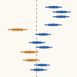
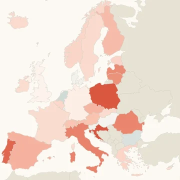
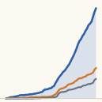
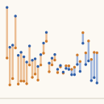

The funded projects behind my <a href="index.html#research">research agendas</a>, with their funding, team and outputs.

::: {.agenda-row .proj-row}

::: {.agenda-body}
## The Normative Integration Regime: How Differential Expectations Shape Immigrant Societies {#nwo}

<dl class="proj-meta">
<dt>Funding</dt><dd>Dutch Research Council (NWO), Open Competition XS (2026–2027) nccr – on the move, collaborative project grant “Contested Liberalism in Diverse Societies: Migration, Diversity and Support for Liberal Values” (2020)</dd>
<dt>Role</dt><dd>Principal investigator, Vrije Universiteit Amsterdam</dd>
<dt>Team</dt><dd>Stefan Manser-Egli, Guido Priem</dd>
</dl>

<i class="bi bi-journal-text"></i><a class="agenda-pubs" data-pr="nwo" href="publications.html#project=nwo">Publications</a> · <i class="bi bi-link-45deg"></i><a href="https://doi.org/10.1162/euso.a.30" target="_blank" rel="noopener">Pilot study (DOI)</a>

Project description

Beyond formal immigration policies, societies hold unwritten expectations about how immigrants should behave—but we lack systematic evidence on these rules. Do people expect more from immigrants than from others? Do they think society is stricter than it actually is? This research surveys 2,500 Dutch residents to map these expectations across everyday behaviours like civic participation, cultural practices, and social interactions. By comparing what people personally believe with what they think others expect, and examining whether identical behaviours are judged differently depending on who performs them, the study reveals how informal expectations shape integration debates and policy preferences in diverse societies.

:::
:::

::: {.agenda-row .proj-row}

::: {.agenda-body}
## Connecting countries and dividing people: The politics of burden-sharing in European migration governance {#ambizione}

<dl class="proj-meta">
<dt>Funding</dt><dd>Swiss National Science Foundation, Ambizione grant (2023–2027)</dd>
<dt>Role</dt><dd>Principal investigator, University of Geneva</dd>
<dt>Team</dt><dd>Maud Bachelet, Frowin Rausis, Walter Bartl, Ben Crum, Diego Caballero-Vélez, Florian Trauner, Philipp Stutz</dd>
</dl>

<i class="bi bi-journal-text"></i><a class="agenda-pubs" data-pr="ambizione" href="publications.html#project=ambizione">Publications</a> · <i class="bi bi-bar-chart-line"></i><a href="projects.html#dublin-explorer">Dublin Explorer</a> · <i class="bi bi-database"></i><a href="data.html#uraf">Datasets</a> · <i class="bi bi-box-arrow-up-right"></i><a href="https://data.snf.ch/grants/grant/208858" target="_blank" rel="noopener">SNSF grant page</a>

Project description

Migration is both the most visible consequence of globalisation and the main factor behind the political backlash against a more interconnected world. European countries experience a growing number of immigrants, which is leading to a mounting political crisis in the absence of adequate governance responses. The conjuncture of open borders within Europe and exposure to external immigration requires collective efforts to effectively govern migration through burden-sharing. This project seeks to understand how the contrasting pressures stemming from this functional interdependence and domestic political contestation shape the politics of burden-sharing in refugee protection and in migration control: When and how do European countries contribute to European burden-sharing in migration governance? What interests and ideas drive burden-sharing politics in European democracies? 

To address these questions, I develop an innovative conceptual and theoretical framework of burden-sharing politics that combines an international relations perspective on functional interdependence and international norms with a comparative politics perspective on identitarian politics and domestic politicisation. I propose the concept of multi-level burden-sharing where European countries contribute to collective migration governance across three levels of policy-making – through their domestic legislation, through their participation in the common European migration policy and through their cooperation with third countries. I seek to explain states’ burden-sharing behaviour by combining an interest-based perspective of exposure to international migration and an idea-based perspective of values and identities mobilised in response to immigration. I focus on two key policy areas of migration governance that differ in terms of how they incorporate interests and ideas: refugee protection and migration control. 

The research design combines a quantitative-comparative analysis of policy outcomes (Work Package 1) with comparative case studies to examine domestic policy processes (Work Package 2). WP 1 builds a comprehensive burden-sharing index that covers 31 European countries between 1990 and 2020 to identify the explanatory factors behind states’ contributions to European burden-sharing. WP2 investigates domestic preference formation and the political conflict surrounding burden-sharing in three countries with different migration contexts (Germany, Italy, Hungary). I do so by conducting survey experiments among citizens and analysing national parliamentary debates. The combination of macro- and micro-level evidence allows me to draw conclusions about the nature and determinants of burden-sharing politics, as well as the prospects and the limitations of European migration governance. In sum, the project develops an ambitious research agenda meant to break new conceptual and empirical ground in the study of European migration governance. Its integrative theoretical framework and innovative empirical measurements shed light on the fundamental challenge of migration policy-making in our time of contested globalisation. The findings will reveal the underlying drivers and resulting outcomes of burden-sharing politics and thereby help scholars and policy-makers to better understand and address the contemporary crisis in migration governance.

<i class="bi bi-bar-chart-line app-icon" aria-hidden="true"></i>

The Dublin Explorer

Interactive dashboard on Dublin transfers across EU member states, accompanying my work on the fairness of asylum responsibility-sharing.

<a class="app-open" href="https://philipplutz.shinyapps.io/dublin_app/" target="_blank" rel="noopener"><i class="bi bi-box-arrow-up-right"></i>Open the app</a><button type="button" class="app-load" data-src="https://philipplutz.shinyapps.io/dublin_app/" data-title="The Dublin Explorer" data-h="1550"><i class="bi bi-window"></i>Load it here</button>

:::
:::

::: {.agenda-row .proj-row}
<i class="bi bi-globe2"></i>

::: {.agenda-body}
## Migration, Trade and Technology: Responsibility Attribution in a Global Economy {#trade-technology}

<dl class="proj-meta">
<dt>Funding</dt><dd>nccr – on the move, collaborative project grant (since 2024) OECD</dd>
<dt>Team</dt><dd>Juliana Chueri, Anna-Lena Nadler, Mia Gandelberger</dd>
</dl>
<!-- GAP: one sentence on the project (question and design), to be written by Philipp; leave out if not wanted. -->

:::
:::

::: {.agenda-row .proj-row}

::: {.agenda-body}
## Perceptions and Misperceptions about Immigration {#misperceptions}

<dl class="proj-meta">
<dt>Funding</dt><dd>nccr – on the move, collaborative project grant “Putting the Genie Back in the Bottle? How Control Perceptions Shape Immigration Preferences” (2021) FORS Swiss Centre of Expertise in the Social Sciences, MOSAiCH survey module (2023)</dd>
<dt>Team</dt><dd>Marco Bitschnau</dd>
</dl>

<i class="bi bi-journal-text"></i><a class="agenda-pubs" data-pr="misperceptions" href="publications.html#project=misperceptions">Publications</a>

Project description

Issues of immigration are central political challenges for European democracies, with public views often shaped by perceptions rather than reality. Consequently, they tend to fall victim to misperceptions, ranging from innumeracy (i.e., the overestimation of the immigrant share in one’s country) to highly complex conspiracy theories. Both perceptions and misperceptions have been identified as crucial puzzle pieces in explaining policy preferences and political behaviour. In particular, they may foster polarisation and undermine the public’s ability to engage in deliberative decision-making. Still, only in recent years have scholars begun to pay attention to these phenomena, and many major questions regarding their nature and drivers remain insufficiently answered so far. This research agenda seeks to advance our understanding of (mis-)perceptions on a conceptual, theoretical and empirical level. How accurate are public perceptions about immigration? How can we measure them and what methodological pitfalls should be avoided? Are those who hold misperceptions really misinformed or only uninformed? What are the motivations and drivers of particular issue-specific perceptions? What consequences do perceptions have for political preferences and behaviour? To what extent can misperceptions be corrected?

:::
:::

::: {.agenda-row .proj-row}

::: {.agenda-body}
## Migration Governance through Trade Mobilities {#trade-mobilities}

<dl class="proj-meta">
<dt>Funding</dt><dd>Swiss National Science Foundation, nccr – on the move (2019–2022)</dd>
<dt>Role</dt><dd>Postdoctoral researcher, University of Geneva</dd>
<dt>Team</dt><dd>Sandra Lavenex, Paula Hoffmeyer-Zlotnik, Mariana Alvarado, Julia Gubler, Laura Mauricio</dd>
</dl>

<i class="bi bi-journal-text"></i><a class="agenda-pubs" data-pr="mobilities" href="publications.html#project=mobilities">Publications</a> · <i class="bi bi-database"></i><a href="data.html#mita">MITA dataset</a> · <i class="bi bi-bar-chart-line"></i><a href="https://philipplutz.shinyapps.io/MITA/" target="_blank" rel="noopener">MITA Explorer</a> · <i class="bi bi-file-earmark-pdf"></i><a href="publications/IP24.pdf" target="_blank" rel="noopener">Project poster</a> · <i class="bi bi-box-arrow-up-right"></i><a href="https://nccr-onthemove.ch/projects/migration-governance-through-trade-mobilities/" target="_blank" rel="noopener">Project website</a>

Project description

International trade and migration are two important facets of an increasingly interconnected world, yet the links between trade and migration policies remain little researched. States have progressively used trade agreements to govern different aspects of international migration, such as facilitating international mobility, strengthening migration control, or protecting migrant rights. Firstly, we study the drivers and configuration of migration provisions in trade agreements worldwide. For this purpose, we compile a comprehensive database of migration-related content in preferential trade agreements since 1960. Secondly, our project assesses how migration provisions in trade agreements are implemented in national immigration regimes and how they create privileges or disadvantages for different migrants and people on the move through case studies. We focus on four developed economies, two of which belong to a regional economic community and two in the same region which do not: Germany (EU), Switzerland, Singapore (ASEAN), and Japan.

:::
:::

::: {.agenda-row .proj-row}

::: {.agenda-body}
## Inside the Migration State: The Quest for Democratic Legitimacy {#phd}

<dl class="proj-meta">
<dt>Funding</dt><dd>FORS Swiss Centre of Expertise in the Social Sciences, MOSAiCH survey module with Klaus Armingeon (2017)</dd>
<dt>Role</dt><dd>Doctoral researcher, University of Bern (2015–2019)</dd>
<dt>Team</dt><dd>Klaus Armingeon, Caroline Schultz, Stephan Simon</dd>
</dl>

<i class="bi bi-journal-text"></i><a class="agenda-pubs" data-pr="phd" href="publications.html#project=phd">Publications</a> · <i class="bi bi-mortarboard"></i><a href="https://boris-portal.unibe.ch/entities/thesis/6b8c739d-ce3a-423d-9a3d-7bef42cf272e" target="_blank" rel="noopener">PhD thesis</a>

Project description

Migration is an evident consequence of globalisation and at the same time the main concern of European constituencies against a more globalised world. Liberal democracies in Western Europe face a fundamental tension between economic needs to remain open to migration and political demands for closure. This research agenda tackles the dilemma for national governments striving for democratic legitimacy between competing policy imperatives of openness and closure. Thereby, I combine theoretical approaches of democratic representation, political economy and party politics to study policy trade-offs on immigration and to contribute to a better understanding of migration policy-making in the context of contested globalisation.

:::
:::
