::: {#scholar-stats .scholar-stats}
For the most up-to-date list and citation counts, see my [Google Scholar profile](https://scholar.google.com/citations?user=Ml32muAAAAAJ).
:::

::: {#agenda-filter .agenda-filter}
:::

## Peer-reviewed journal articles (31)

### 2026

- []{.ag data-ag="trade" data-pr="mobilities"} **Lutz, P.**, Lavenex, S., & Hoffmeyer-Zlotnik, P. (2026) Trading migration? Explaining mobility provisions in preferential trade agreements. *The Review of International Organizations*, FirstView.  
Economic interdependence and path dependence drive mobility provisions in trade agreements; migration control concerns explain little of their presence, scope or depth.
[PDF](https://rdcu.be/TfLEyduaBCPa){.pub-btn} · [DOI](https://doi.org/10.1007/s11558-026-09654-2){.pub-btn} · [Supplementary material](https://media.springernature.com/original/springer-static/esm/art%3A10.1007%2Fs11558-026-09654-2/MediaObjects/11558_2026_9654_MOESM1_ESM.pdf){.pub-btn} · [Replication files](https://zenodo.org/records/22900298){.pub-btn}

 
    
Abstract

Notwithstanding a generally unfavorable political climate regarding international migration, preferential trade agreements (PTAs) increasingly include provisions facilitating the temporary movement of specific categories of workers. Today, approximately seven in ten newly concluded PTAs contain clauses that enable the mobility of workers and businesspeople—particularly business visitors and intra-corporate transferees, who constitute a substantial share of skilled temporary migration in advanced industrial economies. This trend is striking given states’ longstanding emphasis on preserving sovereign control over migration policy. This article investigates the drivers of mobility provisions in PTAs and the implications for broader economic and migration policy. We develop and test three theoretical logics: (1) a trade logic grounded in interests resulting from economic interdependence; (2) a politics logic centered on migration control objectives; and (3) an institutional logic emphasizing path dependence and diffusion. Drawing on the MITA dataset, which codes mobility provisions in PTAs globally from 1960 to 2020, we find that economic interdependence and institutional path dependence are the primary forces behind mobility provisions, while migration control prerogatives have little explanatory power for either the presence, scope, or depth of these provisions. Our findings underscore the economic rationale behind mobility provisions in trade agreements, highlighting a pattern of selective liberalization for highly skilled workers and an increasingly fragmented landscape of migration governance. <figure class="pub-fig"><a class="fig-zoom" href="figures/lutz_et_al2026_rio.webp">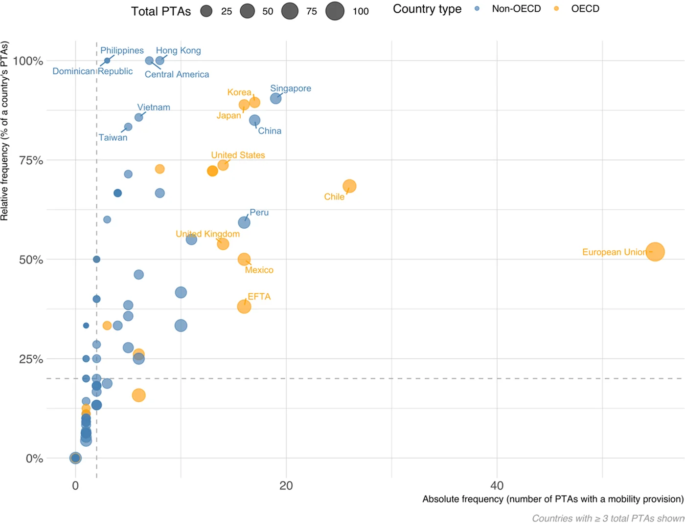</a><figcaption>Figure 2. Absolute and relative frequency of mobility provision by signing parties.</figcaption></figure>

- []{.ag data-ag="sharing opinion" data-pr="ambizione"} **Lutz, P.**, & Crum, B. (2026) Fair enough? Citizens’ preferences on refugee distribution in the EU. *European Journal of Political Research*, FirstView.  
Citizens in six member states broadly support a fairer distribution of refugees in the EU, yet prefer the principles that keep numbers in their own country low.
[PDF](publications/lutz_crum2026.pdf){.pub-btn} · [DOI](https://doi.org/10.1017/S1475676526101595){.pub-btn} · [Supplementary material](publications/lutz_crum2026supp.pdf){.pub-btn} · [Pre-registration](https://osf.io/5bwzc){.pub-btn} · [Replication files](publications/Lutz_Crum_EJPR_replication_files.zip){.pub-btn}

 
    
Abstract

How should asylum seekers be distributed across EU member states? And can EU citizens agree on the principles underlying such distribution? While scholars have proposed various fairness principles – such as allocation based on population size, wealth, or past intake – we know little about which principles citizens support. Using an original population survey in six EU member states, this study examines public preferences for distributive fairness in asylum governance. We find widespread dissatisfaction with the status quo of large asymmetries in refugee numbers and broad support for European responsibility sharing based on fair distribution. However, there are significant differences between member states in the principles that citizens support, and these preferences are also affected by the principles that would keep the number of refugees in their own country at a minimum. These findings suggest that while there is a transnational consensus on the need to move to a fairer distribution of refugees in the EU, its practical operationalisation reveals the deeper political divides on the matter. <figure class="pub-fig"><a class="fig-zoom" href="figures/lutz_crum2026.webp">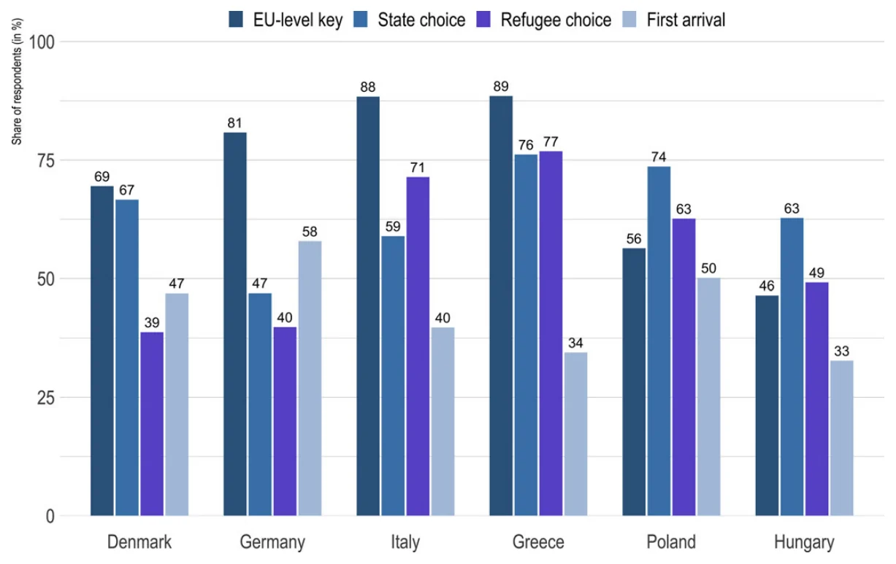</a><figcaption>Figure 3. Procedural fairness preferences by country.</figcaption></figure>

- []{.ag data-ag="opinion" data-pr="misperceptions"} **Lutz, P.**, & Does, S. (2026) Seeing divides: Citizens’ biased perceptions of political cleavages. *Political Behavior*, OnlineFirst.  
Egocentrism, conservatism and false polarization distort how citizens see the immigration cleavage, producing structured misperceptions that mirror political divides.
[PDF](publications/lutz_does2026.pdf){.pub-btn} · [DOI](https://doi.org/10.1007/s11109-026-10181-4){.pub-btn} · [Supplementary material](https://static-content.springer.com/esm/art%3A10.1007%2Fs11109-026-10181-4/MediaObjects/11109_2026_10181_MOESM1_ESM.docx){.pub-btn} · [Replication files](https://doi.org/10.7910/DVN/WIMUVL){.pub-btn}

 
    
Abstract

Citizens’ perceptions of political divides shape democratic processes, yet we know little about how these divides are mentally represented. This article develops a conceptual framework that integrates cleavage theory with the study of meta-perceptions—individuals’ beliefs about the attitudes of social groups—to examine how people cognitively map political cleavages. We argue that these perceptions are systematically distorted by cognitive biases, which operate in three distinct ways: egocentrism (projecting one’s own views onto others), conservatism (assuming others hold more conservative attitudes than they actually do), and false polarization (overestimating attitudinal differences between groups). Using original survey data from Germany and focusing on immigration as a prominent contemporary cleavage issue, we measure cleavage perceptions and introduce a novel method to decompose perceptual errors into three distinct biases. The results provide robust evidence for the presence of all three biases and show that they interact asymmetrically across the cleavage spectrum, producing structured misperceptions that mirror underlying political divides. These findings illuminate the cognitive foundations of political cleavages and suggest that psychological mechanisms embedded in social structures can systematically distort citizens’ understanding of societal divisions, with implications for democratic deliberation and political behavior. <figure class="pub-fig fig-narrow" style="max-width:600px"><a class="fig-zoom" href="figures/lutz_does2026.webp">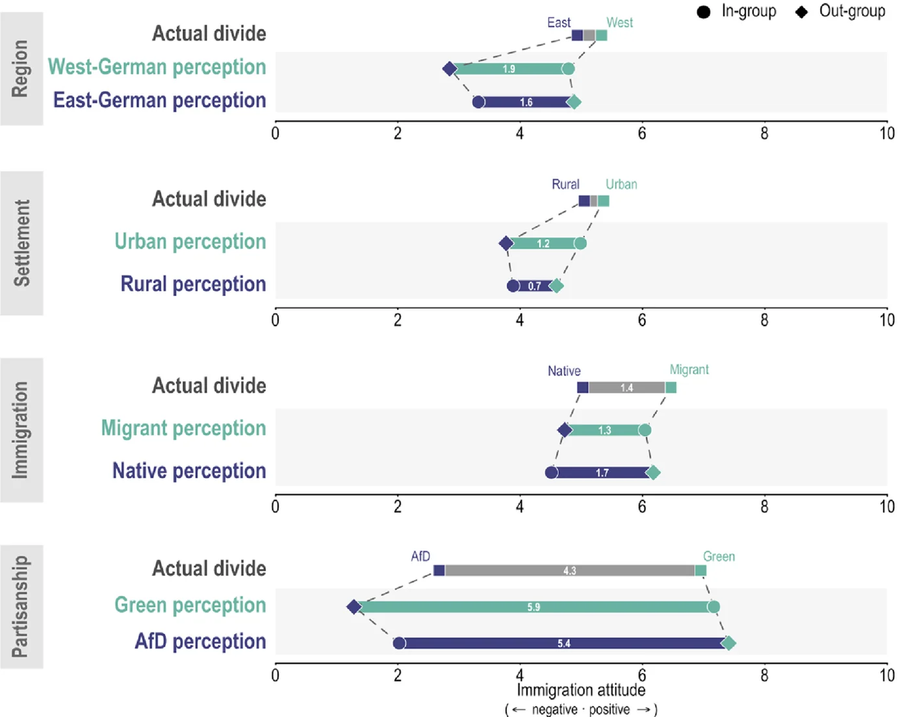</a><figcaption>Figure 2. Egocentric bias and conservatism bias (panel C: bias decomposition).</figcaption></figure>
    

- []{.ag data-ag="sharing" data-pr="ambizione"} **Lutz, P.**, Trauner, F., & Stutz, P. (2026) Towards more fairness among states: How Dublin transfers redistribute asylum responsibility. *European Union Politics*, 27(3): 533–556.  
Dublin transfers modestly reduce the unequal distribution of asylum responsibility among member states, as a result of arrival patterns and partial implementation.
[PDF](publications/lutz_et_al2026_EUP.pdf){.pub-btn} · [DOI](https://doi.org/10.1177/14651165261446534){.pub-btn} · [Supplementary material](publications/lutz_et_al2026_supplementary.pdf){.pub-btn} · [Replication files](EUP_replication_files.zip){.pub-btn} · [Data explorer](https://philipplutz.shinyapps.io/dublin_app/){.pub-btn} · [Blog post](https://blogs.lse.ac.uk/europpblog/2026/05/15/eu-dublin-system-asylum-fairness-statistics/){.pub-btn} · [Policy brief](https://www.epc.eu/publication/towards-a-fairer-eu-asylum-policy-lessons-from-the-dublin-system-for-the-eus-solidarity-mechanism/){.pub-btn} · [Press release](https://vu.nl/en/news/2026/dublin-asylum-system-fairer-than-assumed-but-not-by-design){.pub-btn} · [Op-ed EUobserver](https://euobserver.com/219709/new-data-shows-eus-dublin-asylum-relocation-was-better-than-its-unfair-reputation/){.pub-btn}

 
    
Abstract

    Solidarity and fairness in allocating refugee protection responsibilities is a central challenge in European asylum governance. The Dublin Regulation, assigning responsibility primarily to first countries of entry, has been criticised for exacerbating unequal burdens to member states. Yet systematic evidence on how Dublin transfers affect the distribution of responsibilities remains scarce. This article analyses Dublin statistics from 2008 to 2024 using a distribution key based on member states’ size and wealth as normative benchmark. We assess whether Dublin transfers reduce or exacerbate asymmetries between member states. Contrary to common perceptions, Dublin transfers modestly reduce inequitable distribution of asylum responsibilities, resulting from geographic arrival patterns paired with partial implementation. These findings challenge prevailing critiques and offer insights for evaluating the EU's solidarity mechanism. <figure class="pub-fig"><a class="fig-zoom" href="figures/dublin_scatter.webp">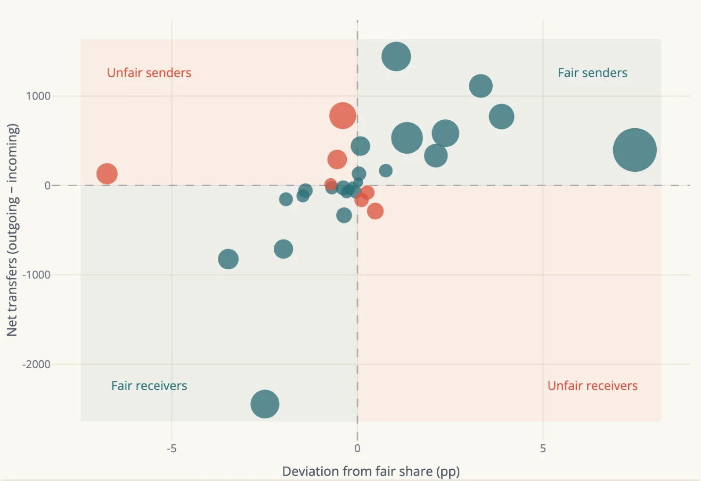</a><figcaption>Countries’ deviation from their fair share and net Dublin transfers, 2008–2024 average. From the <a href="https://philipplutz.shinyapps.io/dublin_app/">Dublin Explorer</a>.</figcaption></figure>
    

- []{.ag data-ag="sharing opinion" data-pr="ambizione"} **Lutz, P.** & Bachelet, M. (2026) Europe's immigration divide: multidimensional responsibility-sharing as a solution? *Journal of European Public Policy*, FirstView.  
Citizens favour financial contributions and joint border control over refugee relocation; ideology drives these preferences across countries, which limits national specialisation.
[PDF](publications/lutz_bachelet2026.pdf){.pub-btn} · [DOI](https://doi.org/10.1080/13501763.2026.2636284){.pub-btn} · [Supplementary material](publications/lutz_bachelet2026_supplementary.pdf){.pub-btn} · [Pre-registration](https://osf.io/7x9nm/overview?view_only=50230b81235849889502c9799d6a66fc){.pub-btn} · [Replication files](lutz_bachelet2026_replication.zip){.pub-btn} · [Policy brief](publications/lutz_bachelet_policybrief.pdf){.pub-btn}

    
Abstract

Immigration poses a fundamental challenge for the European Union, with deep political divisions complicating efforts to achieve effective collective governance. One proposed response is multidimensional responsibility-sharing, in which member states engage in European migration governance through different types of contributions aligned with their capacities and preferences. To what extent can such an approach overcome Europe’s divide on immigration and mobilise public support? Drawing on original survey data from six EU member states, we assess the potential for multidimensional responsibility-sharing by first mapping citizens’ evaluations of different contribution types and, second, analysing whether these preferences reflect countries’ positions in the migration regime or individual ideological orientations. Our findings show broad support for responsibility-sharing and clear differentiation between contribution types: refugee relocation is least preferred, whereas financial contributions and joint border control are more widely accepted. Preference patterns, however, are remarkably consistent across member states and driven primarily by ideology rather than structural characteristics of national contexts. Consequently, the scope for complementary national specialisation in European migration governance is limited. While multidimensional responsibility-sharing may facilitate political adoption of a common policy, it provides limited practical leverage for overcoming Europe's divide on actual contributions to European migration governance. <figure class="pub-fig fig-narrow" style="max-width:640px"><a class="fig-zoom" href="figures/lutz_bachelet2026.webp">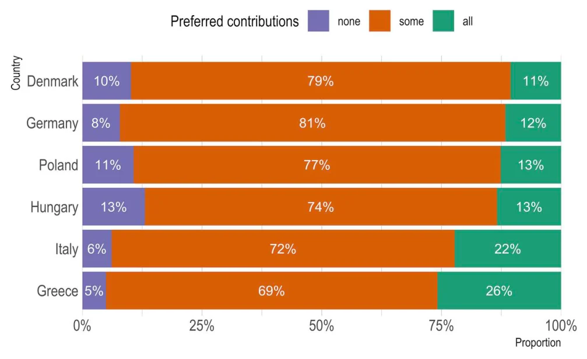</a><figcaption>Figure 1. Public support for responsibility-sharing in migration governance (panel C: mode of responsibility-sharing). Redrawn from the replication data; neutral responses excluded.</figcaption></figure>
  

- []{.ag data-ag="opinion" data-pr="nwo"} Manser-Egli, S. & **Lutz, P.** (2026) Integration for whom? The migration bias in social norms. *European Societies*, 28(3): 569–588.  
Social norms of integration are stronger for immigrants than for society at large: a migration bias found in German-speaking Switzerland.
[PDF](publications/manseregli_lutz2025.pdf){.pub-btn} · [DOI](https://doi.org/10.1162/euso.a.30){.pub-btn} · [Supplementary material](publications/lutz_manseregli_supplementary.pdf){.pub-btn} · [Replication files](lutz_manseregli_replication.zip){.pub-btn} · [Blog post (EN)](https://www.defacto.expert/2025/11/17/integration-dispensation-why-immigrants-face-stronger-social-norms/?lang=en){.pub-btn} · [Blog post (DE)](https://www.defacto.expert/2025/11/17/integrationsdispensation-warum-fuer-migrantinnen-strengere-soziale-normen-gelten/){.pub-btn} · [Blog post (FR)](https://www.defacto.expert/2025/11/17/dispense-dintegration-pourquoi-les-migrant-es-sont-soumis-es-a-des-normes-sociales-plus-strictes/?lang=fr){.pub-btn} · [Blog post (NL)](https://www.socialevraagstukken.nl/migratiesamenleving/voor-immigranten-gelden-strengere-sociale-normen/){.pub-btn}

    
Abstract

Integration has become a dominant framework in the governance of immigration, indicating what states and ‘host societies’ expect immigrants to do and how to behave to become accepted members of the receiving country. Critical scholarship has argued that this creates an unequal normative burden: ‘immigrants’ are subject to integration demands, while ‘native citizens’ are exempt. Despite this widely acknowledged ‘integration dispensation’, the asymmetry of expectations has not been empirically tested. In this article, we conceptualize immigrant integration in terms of social norms—expectations regarding the social, economic, cultural, and political participation—and develop a theory of a migration bias: the idea that these norms are stronger for immigrants than for society at large. We test this hypothesis using a population-based survey experiment in Switzerland. Our results provide evidence for a migration bias, particularly in the social dimension of integration and expectations concerning respect for laws and constitutional values. However, this bias is context dependent, appearing in the German-speaking part of Switzerland but not in the French-speaking counterpart. These findings provide novel insights into the popular understanding of immigrant integration and the nature of social norms and citizenship in diverse societies. <figure class="pub-fig fig-narrow" style="max-width:640px"><a class="fig-zoom" href="figures/manseregli_lutz2026.webp">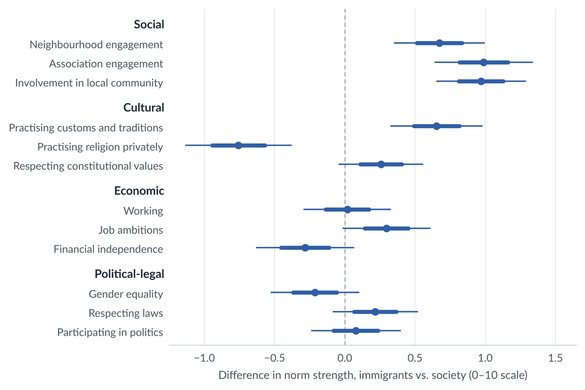</a><figcaption>Figure 2. Estimation of the migration bias in social norms: norm-level estimates. Redrawn from the replication data; thick and thin lines show ±1 and ±2 standard errors.</figcaption></figure>
  

- []{.ag data-ag="sharing" data-pr="ambizione"} **Lutz, P.** & Caballero-Vélez, D. (2026) Refugee protection as a public good: What benefits do states derive? *Perspectives on Politics*, 24(2): 555–570.  
States derive four types of benefits from refugee protection (legitimacy, security, reputation and development), shaped by contested interests and norms.
[PDF](publications/lutz_caballero2024.pdf){.pub-btn} · [DOI](https://doi.org/10.1017/S1537592724001014){.pub-btn} 

    
Abstract

While a growing number of refugees is in need of humanitarian protection, most states are reluctant to admit them. For more than two decades, scholars have thought to understand this intricate challenge of international governance through the prism of collective action theory and the concept of refugee protection as an international public good. However, the specific benefits that states gain from refugee protection and that are assumed to constitute the public good remain surprisingly vague and under-specified. In this Reflection, we make three contributions to address this issue. First, we take stock of the literature and assess the evolution of the collective action theory in asylum governance. Second, we identify and conceptualize legitimacy, security, reputation, and development as four types of benefits that states derive from refugee protection. Third, we discuss the limitations of the dominant rational-choice approach and contend that the nature of refugee protection in the international realm is the product of international and domestic politics based on the contestation of interests and norms. These insights result in a series of recommendations for future research of refugee protection as a collective action problem. <figure class="pub-fig fig-narrow" style="max-width:520px"><a class="fig-zoom" href="figures/lutz_caballero2024.webp">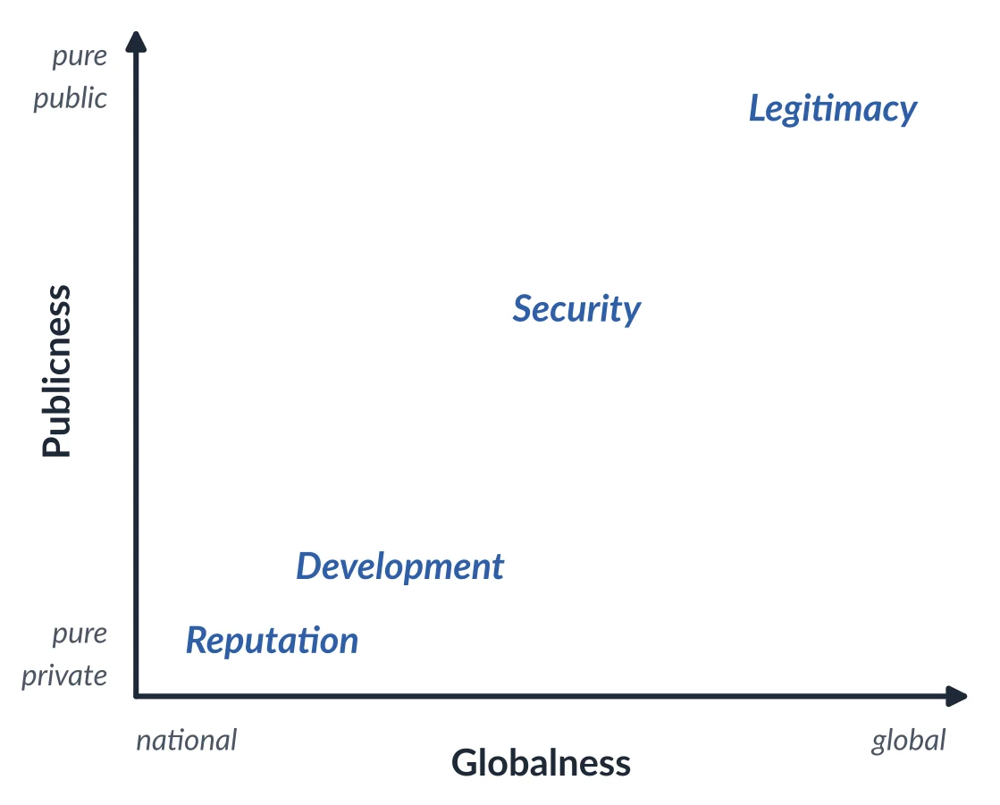</a><figcaption>Figure 1. Benefits of refugee protection by publicness and globalness. Redrawn.</figcaption></figure>
  

- []{.ag data-ag="opinion" data-pr="misperceptions"} **Lutz, P.** & Bitschnau, M. (2026) Beyond innumeracy: Measuring public misperceptions about immigration. *Political Science Research and Methods*, 14(4): 1326–1343.  
Confidence-weighted measures separate misperceptions from guessing: inaccurate perceptions of immigration are widespread, yet less prevalent than often assumed.
[PDF](publications/lutz_bitschnau2025.pdf){.pub-btn} · [DOI](https://doi.org/10.1017/psrm.2025.10055){.pub-btn} · [Supplementary material](publications/lutz_bitschnau2025_supplementary.pdf){.pub-btn} · [Replication files](https://dataverse.harvard.edu/citation?persistentId=doi:10.7910/DVN/EPX9VY){.pub-btn} · [Blog post (EN)](https://theloop.ecpr.eu/why-we-need-to-rethink-what-we-know-about-public-views-on-immigration/){.pub-btn} · [Blog post (DE)](https://nccr-onthemove.ch/blog/fehlannahmen-oder-blosses-raten-einblicke-in-die-offentliche-sicht-auf-migration/){.pub-btn} · [Blog post (FR)](https://nccr-onthemove.ch/blog/croyances-erronees-ou-simples-approximations-comprendre-les-perceptions-du-public-sur-limmigration/){.pub-btn}

    
Abstract

Public perceptions of immigration are often inaccurate, yet research lacks conceptual clarity and valid measurement of these misperceptions. Prior work focuses mainly on population innumeracy (misestimating immigrant shares) and cannot distinguish genuine misperceptions from mere guessing. We introduce a survey module that captures multiple dimensions of immigration-related perceptions alongside respondents’ confidence in their estimates. Using population survey data from Switzerland, we develop confidence-weighted indicators that separate misperception from guessing. Although inaccurate perceptions are widespread across several immigration domains, they are less prevalent than often assumed; guessing accounts for a substantial share of observed inaccuracy. This measurement strategy enables more precise empirical tests of theories linking perceptions to political attitudes and behavior. <figure class="pub-fig fig-narrow" style="max-width:560px"><a class="fig-zoom" href="figures/lutz_bitschnau2025.webp">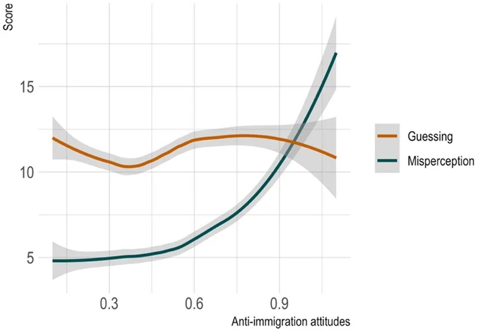</a><figcaption>Figure 4. Association of guessing and misperceptions with anti-immigration attitudes.</figcaption></figure>
  

### 2025

- []{.ag data-ag="policy" data-pr="ambizione"} Bartl, W. & **Lutz, P.** (2025) Comparing refugee dispersal policies: Varieties of responsibility-sharing in Europe. *Governance*, 38(4): e70072.  
Dispersal of asylum seekers is widespread across 32 European countries, mostly in a negotiated model, and more restrictive where past arrivals were high and local autonomy strong.
[PDF](publications/bartl_lutz2025.pdf){.pub-btn} · [DOI](https://doi.org/10.1111/gove.70072){.pub-btn} · [Supplementary material](https://onlinelibrary.wiley.com/action/downloadSupplement?doi=10.1111%2Fgove.70072&file=gove70072-sup-0001-suppl-data.docx){.pub-btn} · [Dataset & Replication](http://dx.doi.org/10.25673/1914118-10.2){.pub-btn}

    
Abstract

Many European countries are concerned about the asymmetric distribution of refugees within their territory. In response, they have developed policies to spatially disperse asylum seekers. Yet, we lack a comprehensive understanding of such refugee dispersal policies (RDPs). This article fills that gap with two contributions. First, we conceptualize RDPs as systems of subnational responsibility-sharing in asylum governance, defined along five policy attributes and three ideal types. Second, we introduce a novel dataset covering the dispersal policies of 32 European countries and develop an index of policy restrictiveness. We show that dispersal is widespread but varies in formality and design. Most countries adopt a negotiated model combining binding spatial allocation, material incentives, and discretionary dispersal criteria. Restrictiveness is higher in states with high past arrivals and strong local autonomy. Our findings offer new insights into the spatial governance of asylum and the institutional design of responsibility-sharing mechanisms. <figure class="pub-fig fig-narrow" style="max-width:560px"><a class="fig-zoom" href="figures/bartl_lutz2025.webp">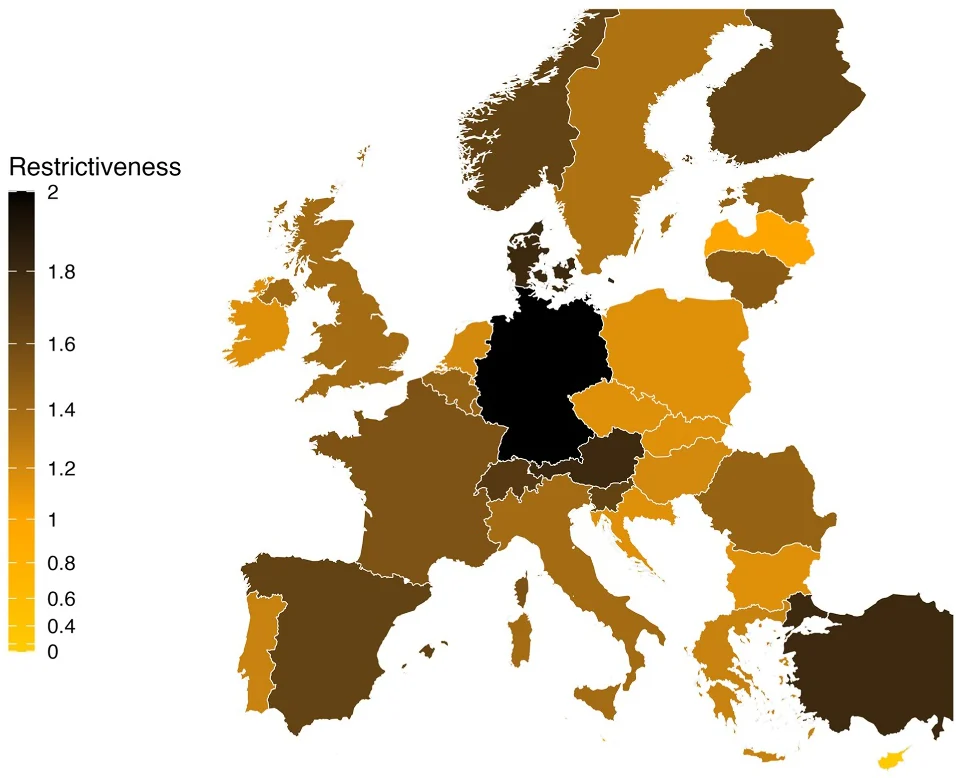</a><figcaption>Figure 1. Restrictiveness of refugee dispersal policy by country (map panel).</figcaption></figure>
  

- []{.ag data-ag="trade policy" data-pr="mobilities"} Lavenex, S., Hoffmeyer-Zlotnik, P., Alvarado, M. & **Lutz, P.** (2025) Attracting migrants through the backdoor: Business migration in Switzerland. *Migration Studies*, 13(3): mnaf028.  
Business migration is an escape route from the liberal paradox: temporary admission, restricted rights and quiet politics reconcile economic openness with political closure.
[PDF](publications/lavenex_et_al2025.pdf){.pub-btn} · [DOI](https://doi.org/10.1093/migration/mnaf028){.pub-btn} · [Supplementary material](https://oup.silverchair-cdn.com/oup/backfile/Content_public/Journal/migration/13/3/10.1093_migration_mnaf028/1/mnaf028_supplementary_data.docx?Expires=1783260961&Signature=eHW0RNwZ7b7rSPqQnTRBok7J4MEKqBHedMZkn7ACpAFOXtQoBLGhW5MSWVOIRyKjzFh00-BD9ZN-AyyEAIYx0EIccwHiApCf5OkCi7OWtH0jQXWoNDnx5IGCJd9~oPlSAXrUrGTtqkTZ2J4eDaJLDAsVSIjKwjQHwAm877AIp81oyF8HLn5tkU9MPPIccii29p~TvFaQF2PFUFQlfc7NCt~YZbPpwrrTGu7TwshisPZ4eEBMIJS4HuktzgDmjjgzqeGlS8eLRQS-SqMWC44r90vYICzXo8CnBhgJO71JoI0I6j-jWHpeKwKmgD6CVo5XGCFpqDxe7oD7aEapIe~jlw__&Key-Pair-Id=APKAIE5G5CRDK6RD3PGA){.pub-btn} 

    
Abstract

In regulating immigration, governments in Western democracies face a ‘liberal paradox’: they must balance economic and judicial pressures to admit and protect migrants with domestic political demands for restriction. A key strategy to navigate this tension is the ‘market model’ of migration policy, which emphasizes temporariness and limited rights. While commonly associated with low-skilled migration, we argue that this model also applies to highly skilled business migration. Business migrants—such as intra-corporate transferees, business visitors, and contractual service suppliers—form a substantial share of labour mobility but do not formally enter host labour markets, circumventing both associated rights and politicization. In this article, we study the policy frameworks and political dynamics surrounding business migration, demonstrating how it serves as an escape route from the liberal paradox. Key characteristics of business migration—temporary admission, restricted rights, ‘quiet politics’, and all-party consensus—enable governments to meet economic demands while limiting political backlash. Analysing Switzerland, a most likely case, we show how business migration operates as a high-skilled variant of the market model, reconciling economic openness with political closure. This study sheds light on the broader implications of business migration for immigration policy and politics in Western democracies. <figure class="pub-fig fig-narrow" style="max-width:660px"><a class="fig-zoom" href="figures/lavenex_et_al2025.webp">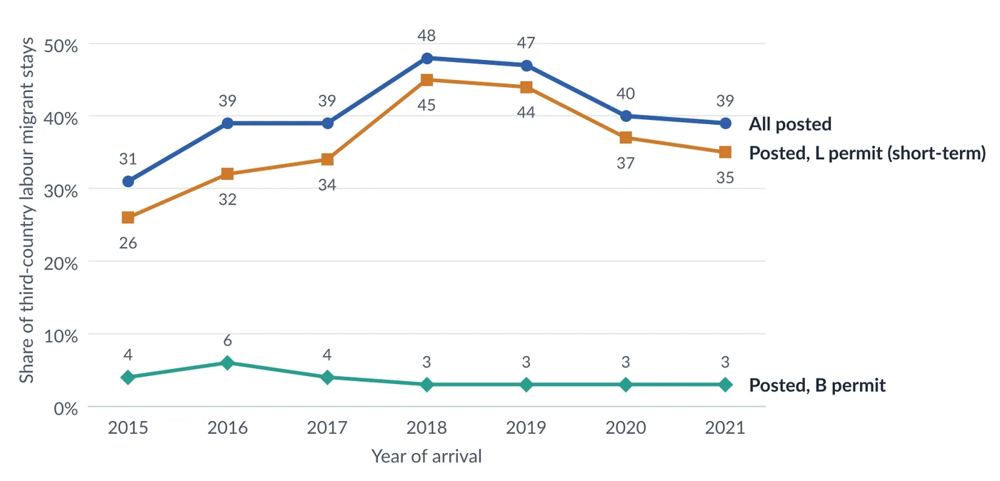</a><figcaption>Figure 1. Annual share of posted stays out of total third-country labour migrant stays. Redrawn from the values printed in the published figure.</figcaption></figure>
  

- []{.ag data-ag="trade policy" data-pr="mobilities"} Alvarado, M., Hoffmeyer-Zlotnik, P., Lavenex, S., & **Lutz, P.** (2025) Business migration between labour and trade: Evidence from Switzerland. *Comparative Migration Studies*, 13(1): 60.  
Business migration makes up nearly half of regulated labour immigration into Switzerland and follows trade, investment and multinational firms; trade agreements show no systematic effect.
[PDF](publications/alvarado_et_al2025.pdf){.pub-btn} · [DOI](https://doi.org/10.1186/s40878-025-00483-7){.pub-btn} · [Supplementary material](https://static-content.springer.com/esm/art%3A10.1186%2Fs40878-025-00483-7/MediaObjects/40878_2025_483_MOESM1_ESM.docx){.pub-btn}

    
Abstract

Largely unnoticed by the migration literature, business migration has established itself as a form of labour migration that is substantial in terms of numbers and receives preferential treatment in international and national migration law. Intra-corporate transferees, contractual service suppliers and business visitors all fall within this category and benefit from facilitated admission procedures agreed under trade agreements and corresponding provisions in national legislation. Assigned for temporary stays and retaining their work contract in the home country, these business migrants represent a “market model” of migration policy exploiting the economic benefits of human movement while avoiding migrants’ integration into the host countries’ labour market and society. This article conceptualizes business migration at the nexus of trade law, international labour markets and migration research and uses a mix of legal analysis, population register and other statistical data as well as survey data from Switzerland to demonstrate the scale and importance of this under-investigated yet significant type of economic migration. Amounting to nearly half of the regulated labour immigration into Switzerland, business migration is strongly associated with trade and investment ties as well as the presence of multinational companies. In contrast, trade agreements facilitating this type of labour mobility have no systematic effect. <figure class="pub-fig fig-narrow" style="max-width:640px"><a class="fig-zoom" href="figures/alvarado_et_al2025.webp">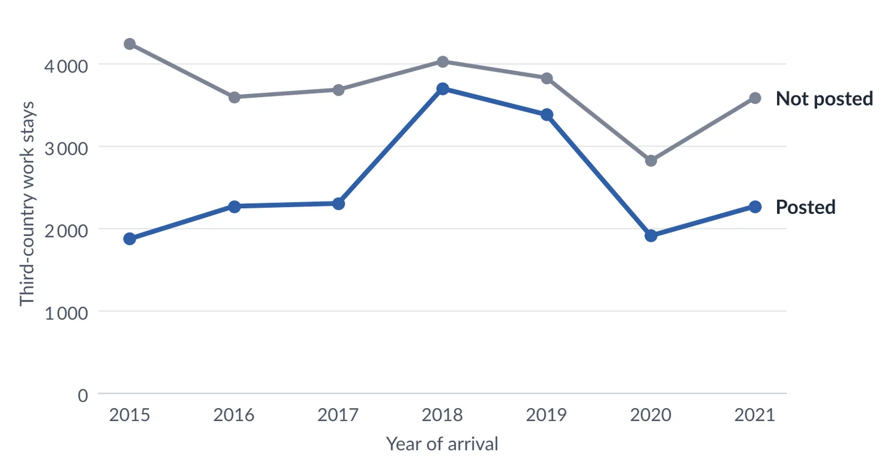</a><figcaption>Figure 2. Annual number of third-country work stays by type in Switzerland. Redrawn from the published figure (source: STATPOP).</figcaption></figure>
  

- []{.ag data-ag="opinion"} **Lutz, P.** (2025) Do immigrants at bay keep the xenophobes away? Post-entry rights and public opposition to immigrant admission. *European Political Science Review*, 17(1): 128–142.  
Restricting immigrants' welfare rights reduces public opposition to their admission in the United States and Switzerland; restricting residence rights does not.
[PDF](publications/lutz2024.pdf){.pub-btn} · [DOI](https://doi.org/10.1017/S1755773924000183){.pub-btn} · [Supplementary material](EPSR2024_supplementary.zip){.pub-btn} · [Replication files](replication_files_EPSR_LUTZ2025.zip){.pub-btn}

    
Abstract

Many citizens in liberal democracies are concerned about immigration and its impact on their countries. Governments often seek to address these concerns by restricting the post-entry rights of immigrants such as the right to permanent settlement or access to welfare benefits. Thereby, it is expected that immigrants with an inferior legal status are (perceived as) less threatening to natives and, as a result, make the latter more willing to accept new immigrants. Does this policy rationale indeed attenuate public opposition to immigrant admission and thus allow for the reconciliation of the economic need for immigrants with the political concerns of domestic constituents? This study advances the theoretical argument of a rights-conditionality in citizens’ immigration preferences and provides empirical evidence on the phenomenon. A factorial survey experiment among citizens in the United States and Switzerland tests the effect of residence and welfare rights on the public opposition to immigrant admission. The results show that restricting immigrants’ welfare rights does significantly decrease public opposition towards immigration across the two countries. In contrast, restricting immigrants’ residence rights does not, and in the context of Switzerland, even increases opposition to immigrant admission. Citizens critical of immigration are thus not per se more welcoming to immigrants if they receive an inferior legal status but seem to care about immigrants’ contributions and commitment to the receiving society. The findings highlight the importance of immigrants‘ post-entry rights in the view of citizens and show how the design of immigration policies may help to understand public immigration preferences. <figure class="pub-fig"><a class="fig-zoom" href="figures/lutz2024.webp">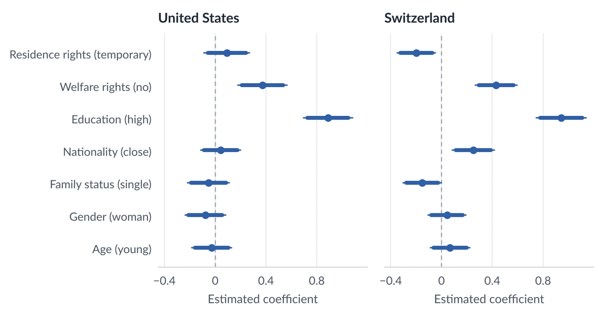</a><figcaption>Figure 1. Coefficient plot of vignette factors (willingness of immigrant admission). Redrawn from the replication data; thick and thin lines show 90% and 95% confidence intervals.</figcaption></figure>
  

### 2024

- []{.ag data-ag="opinion sharing" data-pr="ambizione"} **Lutz, P.** (2024) Between common responsibility and national interest: When do Europeans support a common European migration policy? *European Union Politics*, 25(2): 313–332.  
Refugee arrivals shape support for a common EU migration policy through an identitarian backlash and through instrumental solidarity in line with national interests.
[PDF](publications/lutz2024_EUP.pdf){.pub-btn} · [DOI](https://doi.org/10.1177/14651165241226721){.pub-btn} · [Supplementary material](publications/lutz2024_EUP_appendix.pdf){.pub-btn} · [Replication files](Lutz2024_replication.zip){.pub-btn} 

    
Abstract

The European Union has progressively communitarised its migration policy. The formation of public support for this integration of a core state power presents an intricate puzzle. On the one hand, immigration is part and parcel of the conflict around the opening and closing of nation states, and thereby mobilises nativist views and Euroscepticism. On the other hand, the European Union may serve as a shield against external threats such as uncontrolled immigration. This article sheds light on this conundrum by examining how refugee arrivals affect public support for a common European migration policy across 28 European Union member states between 1992 and 2021. The results lend support to a post-functionalist logic of an identitarian backlash against integration and a collective action logic of instrumental solidarity in line with national interests. <figure class="pub-fig"><a class="fig-zoom" href="figures/lutz2024_eup.webp">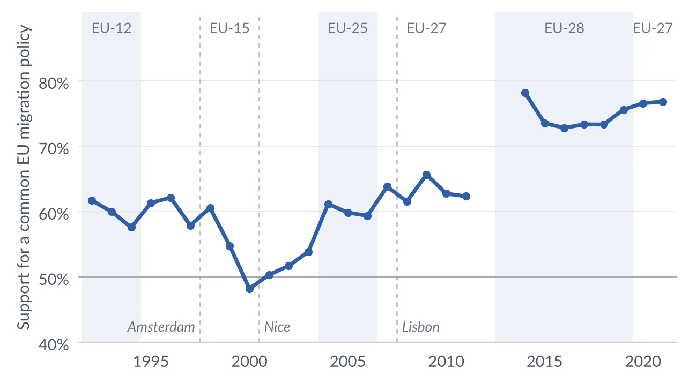</a><figcaption>Figure 1. Evolution of public support for an EU migration policy (weighted annual means, Eurobarometer). Redrawn from the replication data.</figcaption></figure>
  

- []{.ag data-ag="policy"} **Lutz, P.** (2024) Allowing mobility and preventing migration? The combination of entry and stay in immigration policies. *West European Politics*, 47(4): 840–866.  
Most liberal democracies favour temporary mobility over permanent settlement in labour migration, a preference that weakens as countries become familiar with large-scale immigration.
[PDF](publications/lutz2023.pdf){.pub-btn} · [DOI](https://doi.org/10.1080/01402382.2023.2185852){.pub-btn} · [Supplementary material](https://ndownloader.figstatic.com/files/39704393){.pub-btn}

    
Abstract

Western democracies have an economic interest in admitting immigrants but at the same time they fear the political costs of doing so. A recurring idea to help reconcile this tension is to allow for temporary mobility of immigrants while restricting their permanent settlement. Trying to shed light on this matter, this article studies whether and when liberal democracies design immigration policies that prioritise (temporary) mobility over (permanent) migration. First, the underlying rationale of states for such a mobility preference is identified, before conceptualising the temporal design of immigration policies based on the combination of entry and stay regulations. Second, three theoretical explanations for the variation of countries’ mobility preference are developed: liberal constraints, institutional path-dependence and domestic politics. Third, a comparative analysis tests the arguments by studying the combination of entry and stay regulations in the immigration policies of 33 OECD countries between 1980 and 2010. The results confirm that most liberal democracies have a mobility preference in their immigration policies, but largely confined to labour migration and to a declining degree over the past decades. The temporal design of immigration policies is path-dependent on historical immigration regimes with a tendency towards a lower mobility preference the more countries become familiar with large-scale immigration. <figure class="pub-fig fig-narrow" style="max-width:500px"><a class="fig-zoom" href="figures/lutz2023.webp">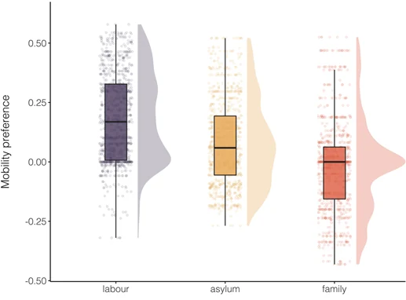</a><figcaption>Figure 3. Mobility preference across admission channels (panel a).</figcaption></figure>
  

- []{.ag data-ag="trade" data-pr="mobilities"} Lavenex, S., **Lutz, P.**, & Hoffmeyer-Zlotnik, P. (2024) Migration governance through trade agreements: Insights from the MITA dataset. *The Review of International Organizations*, 19(1): 147–173.  
Trade agreements facilitate mobility mainly for the highly skilled between developed economies, add control provisions in North–South agreements, and include migrant rights that do not deepen over time.
[PDF](publications/lavenex_et_al2023.pdf){.pub-btn} · [DOI](https://doi.org/10.1007/s11558-023-09493-5){.pub-btn} · [Dataset](https://zenodo.org/records/7837954){.pub-btn} · [Supplementary material](https://static-content.springer.com/esm/art%3A10.1007%2Fs11558-023-09493-5/MediaObjects/11558_2023_9493_MOESM1_ESM.docx){.pub-btn} · [Replication files](https://static-content.springer.com/esm/art%3A10.1007%2Fs11558-023-09493-5/MediaObjects/11558_2023_9493_MOESM2_ESM.zip){.pub-btn} · [Blog post](https://migrationpolicycentre.eu/what-do-trade-agreements-have-to-do-with-migration-policy/){.pub-btn}

    
Abstract

States struggle to establish multilateral cooperation on migration – yet they include more and more migration provisions in preferential trade agreements (PTAs). This article sheds light on this phenomenon by introducing the Migration Provisions in Preferential Trade Agreements (MITA) dataset. Covering 797 agreements signed between 1960 and 2020, this dataset offers a fine-grained coding of three types of migration provisions: those that facilitate the international mobility of service providers and labor migrants, protect migrant rights, and control unauthorized migration. Against the backdrop of limping multilateralism, we examine PTAs’ migration policy content with regard to two key cooperation dilemmas: conflicts of interest within developed countries and between them and developing countries. Facilitating business and labor mobility might be a possible way around the first dilemma, commonly referred to as the ‘liberal paradox': the tension between economic demands for openness and political calls for closure. Nevertheless, this facilitation is largely limited to highly skilled migrants and agreements between developed economies. Provisions for migration control tend to be included in agreements between developed and developing countries, which signals that states use issue-linkages to address the second dilemma, i.e. interest asymmetries. Finally, provisions for migrant rights stand out because they do not deepen over time. Our findings suggest that while PTAs have become an increasingly common venue for migration governance, the issue-linkage between trade and migration cooperation perpetuates entrenched divisions in the international system. The MITA dataset will allow researchers and policymakers to track the evolution of the trade-migration nexus and systematically investigate the motives for and effects of various migration provisions in PTAs. <figure class="pub-fig"><a class="fig-zoom" href="figures/lavenex_et_al2023.webp">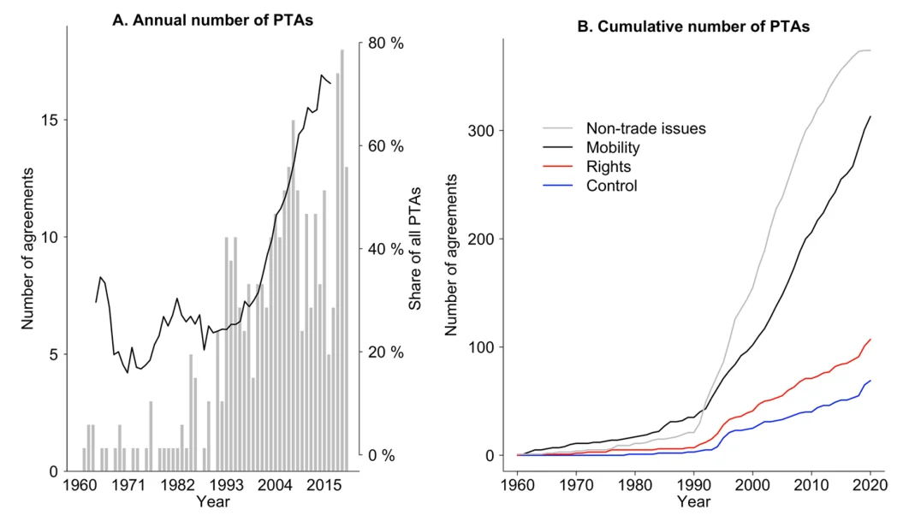</a><figcaption>Figure 2. Evolution of PTAs with migration provisions. Drawn from the current MITA dataset (version 2).</figcaption></figure>
  

- []{.ag data-ag="trade" data-pr="mobilities"} Hoffmeyer-Zlotnik, P., Lavenex, S., & **Lutz, P.** (2024) The limits of EU market power in migration externalization: Explaining migration control provisions in EU preferential trade agreements. *Journal of Common Market Studies*, 62(5): 1351–1378.  
Migration control provisions in EU trade agreements follow the EU's institutional negotiation framework, which shows the limits of using trade as a lever on migration.
[PDF](publications/hoffmeyerzlotnik_et_al2024.pdf){.pub-btn} · [DOI](https://doi.org/10.1111/jcms.13563){.pub-btn} 

    
Abstract

The European Union (EU) increasingly seeks cooperation with transit and sending countries to prevent irregular migration and enforce returns. Yet, these countries have little incentives to engage in such cooperation. To overcome interest asymmetries, the EU has sought to link trade and migration control in its preferential trade agreements (PTAs). Drawing on a comprehensive dataset of migration provisions in all PTAs signed between 1960 and 2020 and a qualitative analysis of key policy documents, we show that the inclusion of such provisions does not follow patterns of interdependence and strategic priorities resulting from problem pressure. Rather, the proliferation of migration control provisions in EU PTAs is best explained by the institutional framework guiding the negotiation of these provisions. Whilst reflecting the political will to use PTAs as a ‘carrot’ to incite third-country cooperation, these findings also show the limits of targeted action on migration control via commercial policies. <figure class="pub-fig"><a class="fig-zoom" href="figures/hoffmeyerzlotnik_et_al2024.webp">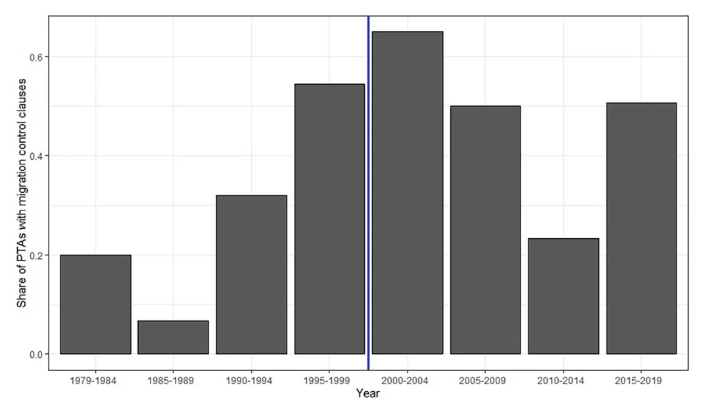</a><figcaption>Figure 3. Share of Preferential Trade Agreements (PTAs) With Migration Control Clauses Over Time.</figcaption></figure>
  

### 2023

- []{.ag data-ag="sharing"} Lavenex, S. & **Lutz, P.** (2023) Third country access to EU agencies: Exploring spaces for influence. *Journal of Common Market Studies*, 61(6): 1563–1586.  
Third countries' access to 26 EU agencies has widened; agency autonomy and mandate, and the democracy, capacity and wealth of third countries, predict its extent.
[PDF](publications/lavenex_lutz2023.pdf){.pub-btn} · [DOI](https://doi.org/10.1111/jcms.13455){.pub-btn} · [Supplementary material](https://onlinelibrary.wiley.com/action/downloadSupplement?doi=10.1111%2Fjcms.13455&file=jcms13455-sup-0001-Online+Appendix_submission.docx){.pub-btn}

    
Abstract

EU decentralised agencies dispose of a wide network of external relations giving third countries various degrees of access to their management boards, secondary bodies and/or operational cooperation. These venues constitute hitherto under-explored opportunities for third country influence on EU laws and policies. Based on an original dataset, this article maps the widening scope and depth of third country de jure access to 26 EU agencies over time and provides first explanations for the variation across agencies and countries. We find that agency autonomy and international mandate as well as third country democracy, regulatory capacity, and wealth are positively correlated with access. Whilst the de jure provisions examined in this article capture the formal institutional scope for third country influence, they underline the potential for more detailed case studies on de facto third country influence and its determinants. <figure class="pub-fig"><a class="fig-zoom" href="figures/lavenex_lutz2023.webp">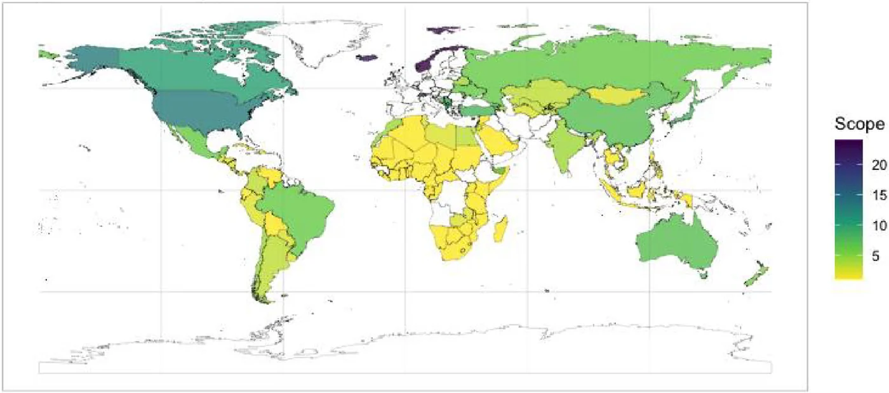</a><figcaption>Figure 2. Scope and Depth of Third Country Access in EU Agencies (scope panel).</figcaption></figure>
  

- []{.ag data-ag="trade" data-pr="mobilities"} Lavenex, S., Hoffmeyer-Zlotnik, P., & **Lutz, P.** (2023) Expanding, complementing, or substituting multilateralism? EU preferential trade agreements in the migration regime complex. *Politics and Governance*, 11(2): 49–61.  
EU trade agreements mostly substitute multilateral migration norms, pursuing objectives that depart from those of existing international institutions.
[PDF](publications/hoffmeyerzlotnik_et_al2023.pdf){.pub-btn} · [DOI](https://doi.org/10.17645/pag.v11i2.6341){.pub-btn} · [Supplementary material](https://www.cogitatiopress.com/politicsandgovernance/article/downloadSuppFile/6341/3069){.pub-btn}

    
Abstract

Intense pressure for international solutions and weak support for multilateral cooperation have led the EU to increasingly rely on its strongest foreign policy tool in the pursuit of migration policy goals: preferential trade agreements (PTAs). Starting from the fragmentary architecture of the migration regime complex we examine how the relevant content of the EU PTAs relates to multilateral institutions. Depending on the constellation of policy objectives, EU competence, and international interdependence, we propose a set of hypotheses regarding the conditions under which EU bilateral outreach via PTAs expands, complements, or substitutes international norms. Based on an original dataset of migration provisions in all EU PTAs signed between 1960 and 2020, we find that the migration policy content in EU PTAs expands or complements the objectives of multilateral institutions only to a very limited extent. Instead, the predominant constellation is one of substitution in which the EU uses its PTAs to promote migration policy objectives that depart from those of existing multilateral institutions. <figure class="pub-fig"><a class="fig-zoom" href="figures/hoffmeyerzlotnik_et_al2023.webp">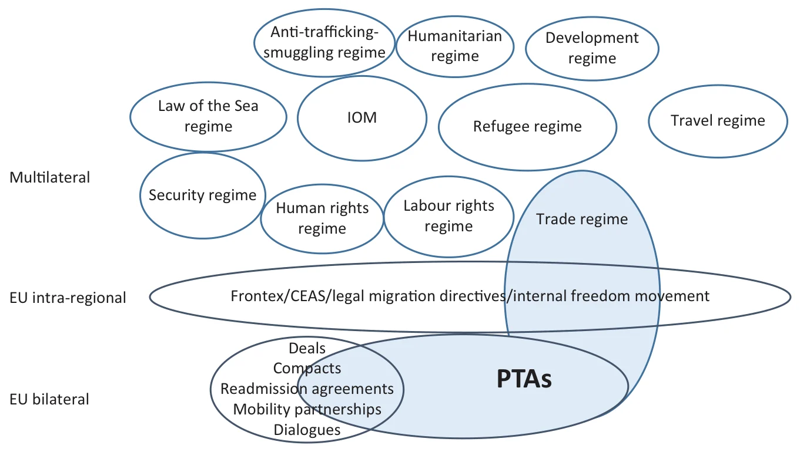</a><figcaption>Figure 1. The multi‐layered migration regime complex.</figcaption></figure>
  

- []{.ag data-ag="opinion" data-pr="misperceptions"} **Lutz, P.** & Bitschnau, M. (2023) Misperceptions about immigration: Reviewing their nature, motivations and determinants. *British Journal of Political Science*, 53(2): 674–689.  
Misperceptions about immigration are ubiquitous, rooted in group identity, self-interest and security concerns, and likely to remain central to immigration politics.
[PDF](publications/lutz_bitschnau2023.pdf){.pub-btn} · [DOI](https://doi.org/10.1017/S0007123422000084){.pub-btn} · [Supplementary material](https://static.cambridge.org/content/id/urn:cambridge.org:id:article:S0007123422000084/resource/name/S0007123422000084sup001.docx){.pub-btn} · [Blog post](https://theloop.ecpr.eu/misperceptions-drive-immigration-politics-and-undermine-democracy/){.pub-btn}

    
Abstract

Across Western democracies, immigration has become one of the most polarizing and salient issues, with public discourses and individual attitudes often characterized by misperceptions. This condition undermines people's ability to develop informed opinions on the matter and runs counter to the ideal of deliberative democracy. Yet, our understanding of what makes immigration so prone to misperceptions is still limited – a conundrum that this review seeks to answer in three steps. First, we take stock of the existing evidence on the nature of misperceptions about immigration. Secondly, we borrow from diverse bodies of literature to identify their motivational underpinnings and elaborate on how the protection of group identity, the defence of self-interest and security concerns can lead to distorted perceptions of immigration. Thirdly, we highlight relevant determinants of misperceptions at the level of both contextual influences and individual predispositions. We conclude that misperceptions about immigration are ubiquitous and likely to remain a key element of immigration politics.
  

- []{.ag data-ag="opinion policy" data-pr="phd"} Armingeon, K. & **Lutz, P.** (2023) Citizens' response to a non-responsive government: The case of the Swiss initiative on mass immigration. *Comparative European Politics*, 21(2): 133–151.  
When the Swiss vote to curb EU immigration went unimplemented, citizens kept their preferences and rationalised the failure in line with their partisan views.
[PDF](publications/armingeon_lutz2023.pdf){.pub-btn} · [DOI](https://doi.org/10.1057/s41295-022-00306-4){.pub-btn} · [Supplementary material](https://static-content.springer.com/esm/art%3A10.1057%2Fs41295-022-00306-4/MediaObjects/41295_2022_306_MOESM1_ESM.docx){.pub-btn}

    
Abstract

In times of contested globalization, democratic governments have increasing difficulties to reconcile international obligations with domestic political demands. Unresponsiveness to domestic constituents due to international constraints may threaten to undermine democratic legitimacy. We assess how citizens react to non-responsive governments in the case of a high-stake direct-democratic vote in Switzerland. The 2014 referendum on restricting immigration from the European Union failed in its implementation because of the EU's refusal to negotiate the free movement rights of its citizens. How did Swiss citizens adapt their policy preferences to this implementation failure? Drawing on original survey data, we show that citizens overwhelmingly did not adapt their policy preferences; rather, they rationalized the implementation failure in an effort to protect their ideological and partisan orientations. The results suggests that governments face major challenges to convey constrained policy choices to their citizens. <figure class="pub-fig"><a class="fig-zoom" href="figures/armingeon_lutz2023.webp">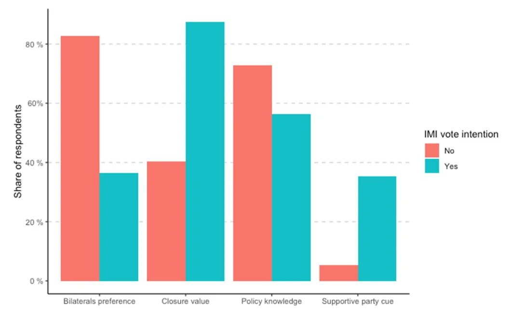</a><figcaption>Figure 1. Preferences, knowledge, cues and values by vote intention.</figcaption></figure>
  

### 2022

- []{.ag data-ag="policy sharing"} **Lutz, P.** & Portmann, L. (2022) Why do states admit refugees? A comparative analysis of resettlement policies in OECD countries. *Journal of Ethnic and Migration Studies*, 48(11): 2515–2539.  
Wealth predicts whether OECD countries resettle refugees; states combine resettlement with restrictive border control to preserve their humanitarian credentials while curtailing access to asylum.
[PDF](https://access.archive-ouverte.unige.ch/access/metadata/621a7669-0163-4431-824b-523c6d67b127/download){.pub-btn} · [DOI](https://doi.org/10.1080/1369183X.2021.1999222){.pub-btn} · [Dataset](https://zenodo.org/records/5762158){.pub-btn} · [Blog post](https://theloop.ecpr.eu/western-countries-use-resettlement-policies-strategically/){.pub-btn}

    
Abstract

Many refugee-receiving countries have restricted their asylum policies and stepped up their border control policies to prevent asylum seekers from reaching their territories. At the same time, the resettlement of refugees has gained popularity. Many states have introduced resettlement schemes or have increased the number of refugees they resettle. Why do states voluntarily admit refugees by expanding resettlement? This article develops a comprehensive theoretical account of countries’ resettlement choices and identifies the determinants of their openness to refugee resettlement through an empirical analysis of 33 OECD countries between 1980 and 2019. We find that the supply-side factor of wealth best predicts whether a country engages in refugee resettlement. The number of effective resettlement admissions tends to fluctuate with the demand-side factor of humanitarian need. Nevertheless, the expansion of resettlement policies has not resulted in a subsequent expansion of humanitarian protection. Instead, states combine resettlement policies with restrictive border control policies which allows them to preserve their humanitarian credentials while curtailing refugees’ overall access to asylum. These findings provide important insights into the policy-making of refugee resettlement and the strategic considerations in the asylum governance of liberal democracies. <figure class="pub-fig"><a class="fig-zoom" href="figures/lutz_portmann2022.webp">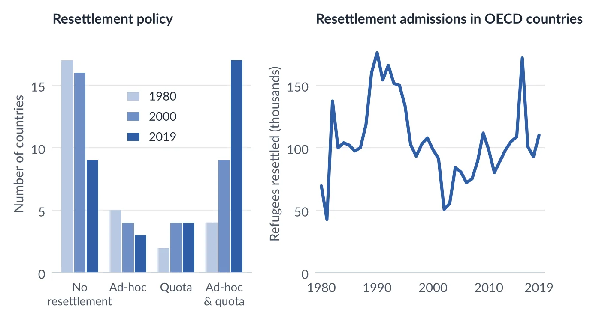</a><figcaption>Figure 2. The evolution of resettlement over time. Number of countries per resettlement policy category in 1980, 2000 and 2019 (Eastern European countries not included in 1980), and total refugees resettled in OECD countries, 1980–2019. Redrawn from the published figure.</figcaption></figure>
  

### 2021

- []{.ag data-ag="policy" data-pr="phd"} Schultz, C., **Lutz, P.**, & Simon, S. (2021) Explaining the immigration policy mix: Countries’ relative openness to asylum and labour migration. *European Journal of Political Research*, 60(4): 763–784.  
Despite a political shift in favour of labour migration, OECD countries' policies towards asylum and labour migration have converged on more liberal mixes.
[PDF](publications/schultz_et_al2021.pdf){.pub-btn} · [DOI](https://doi.org/10.1111/1475-6765.12422){.pub-btn} · [Supplementary material](https://static.cambridge.org/content/id/urn%3Acambridge.org%3Aid%3Aarticle%3AS0304413000016751/resource/name/S0304413000016751sup001.pdf){.pub-btn} · [Replication files](Schultz2021_replication.zip){.pub-btn}

    
Abstract

Western democracies have developed complex policies to manage migration flows. Much of the scholarly literature and political discourse assume that countries have become increasingly selective and that they prioritise economic intakes. Despite clear efforts by policymakers to distinguish between refugees and migrant workers, we know surprisingly little about how countries combine different policy dimensions and which factors shape their relative openness to different target groups. In this article, we shed light on how countries combine two of the main admission channels, asylum and labour migration, by introducing the concept of the ‘immigration policy mix’. A comparative analysis of 33 OECD countries between 1980 and 2010 examines the pattern and drivers behind their immigration policy mix: Does the policy mix follow a pattern of convergence, is it subject to political dynamics or is it path dependent? The results reveal that despite a shift in political sympathies from asylum to labour migration, countries' immigration policy mixes have strongly converged into more liberal policies overall. The immigration policy mix primarily reflects governments’ limited room to manoeuvre due to competing political pressures. These insights demonstrate that the immigration policy mix serves to enhance our understanding of countries’ complex regulation of immigration. <figure class="pub-fig fig-narrow" style="max-width:640px"><a class="fig-zoom" href="figures/schultz_et_al2021.webp">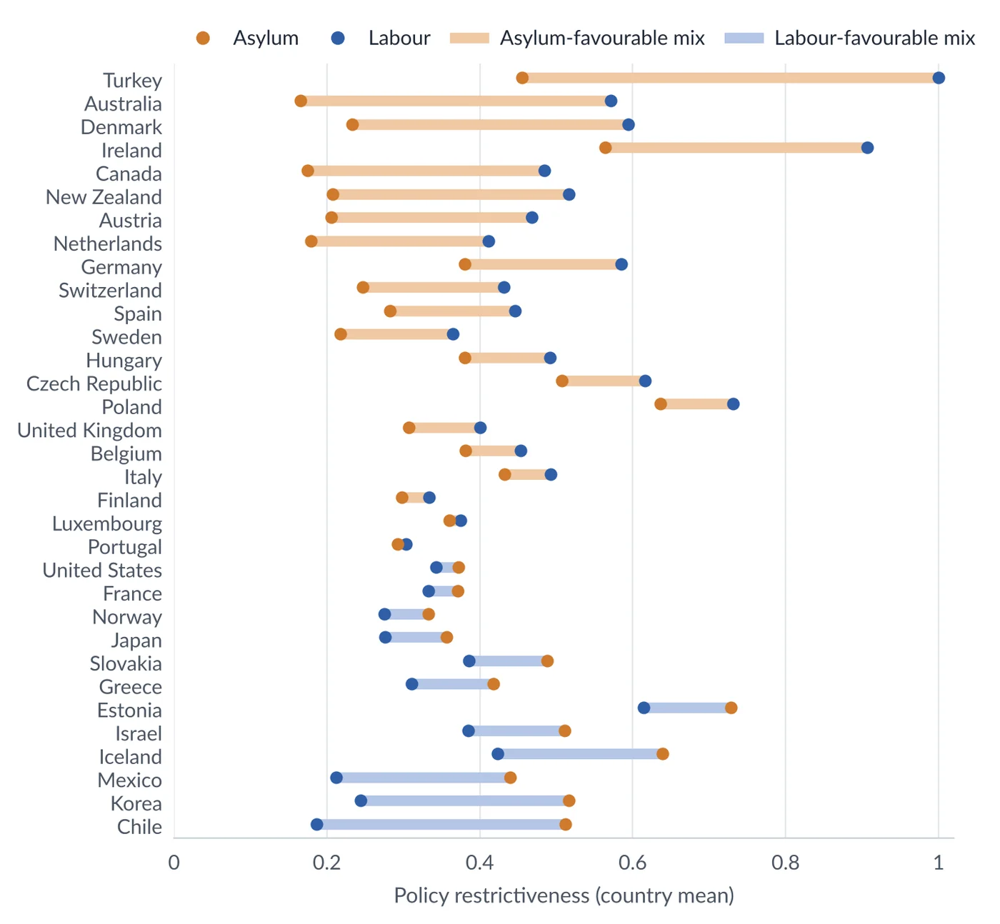</a><figcaption>Figure 1. Immigration policy mix across countries. Redrawn from the replication data.</figcaption></figure>
  

- []{.ag data-ag="sharing"} **Lutz, P.**, Stünzi, A., & Manser-Egli, S. (2021) Responsibility-sharing in refugee protection: Lessons from climate governance. *International Studies Quarterly*, 65(2): 476–487.  
Equity principles from climate governance, such as common but differentiated responsibilities, can guide how states share responsibility for refugee protection.
[PDF](https://access.archive-ouverte.unige.ch/access/metadata/e33e9018-2c17-4da0-93f0-5a1e870c941b/download){.pub-btn} · [DOI](https://doi.org/10.1093/isq/sqab016){.pub-btn} · [Blog post](https://www.rsc.ox.ac.uk/rethinking-refuge-blog/making-responsibility-sharing-operational-comparing-asylum-and-climate-governance){.pub-btn}

    
Abstract

The international governance of asylum requires states to cooperate to provide the public good of humanitarian protection. The need to establish responsibility-sharing resembles the collective action problem in climate change mitigation. While there is a general consensus on the differentiation of state responsibilities in most environmental agreements, states continuously fail to progress on responsibility-sharing in asylum governance. In this article, we compare the collective action challenges in asylum to those in climate governance and identify the similarities and differences in their characteristics as public goods. We then discuss the principle of “common but differentiated responsibilities” that guides global climate change mitigation and demonstrate how equity principles can be applied to differentiate state responsibilities in the context of humanitarian protection. The subsequent analysis of recent efforts to establish effective responsibility-sharing reveals the trade-offs involved in the design of a responsibility allocation mechanism for refugee protection. Our findings provide important lessons for the prospects and limits of responsibility-sharing in asylum governance.
  

- []{.ag data-ag="opinion sharing"} **Lutz, P.** & Karstens, F. (2021) External borders and internal freedoms: How the refugee crisis shaped the bordering preferences of European citizens. *Journal of European Public Policy*, 28(3): 370–388.  
The 2015 refugee crisis increased support for external border control without undermining support for free movement within the EU.
[PDF](publications/lutz_karstens2021.pdf){.pub-btn} · [DOI](https://doi.org/10.1080/13501763.2021.1882541){.pub-btn} · [Supplementary material](https://ndownloader.figstatic.com/files/26436923){.pub-btn} · [Blog post](https://blogs.lse.ac.uk/europpblog/2021/02/25/how-the-2015-migration-crisis-shaped-the-bordering-preferences-of-eu-citizens/){.pub-btn}

    
Abstract

The idea that internal inclusion requires external exclusion features prominently in many theoretical accounts of modern statehood and citizenship. In a similar vein, it has been argued that internal freedom of movement in the European Union requires strict immigration control at its external borders. This article sheds light on the relationship between internal de-bordering and external re-bordering, making two main contributions. First, we theorise the idea of an integration-demarcation conditionality based on the European Union's symbolic legitimacy and functional needs. Second, we test the common belief that public support for free movement within Europe depends on a restrictive border regime for non-European immigration. For this purpose, we assess how the external shock of the 2015 refugee crisis shaped the bordering preferences of European citizens. We find that the crisis primarily increased citizens’ support for external re-bordering, and did not substantially undermine their support for internal free movement. Thus, the large-scale arrival of refugees has not led to a general backlash against open borders and immigration but has, rather, increased public support for the European model of combining internal freedoms with external controls. <figure class="pub-fig"><a class="fig-zoom" href="figures/lutz_karstens2021.webp">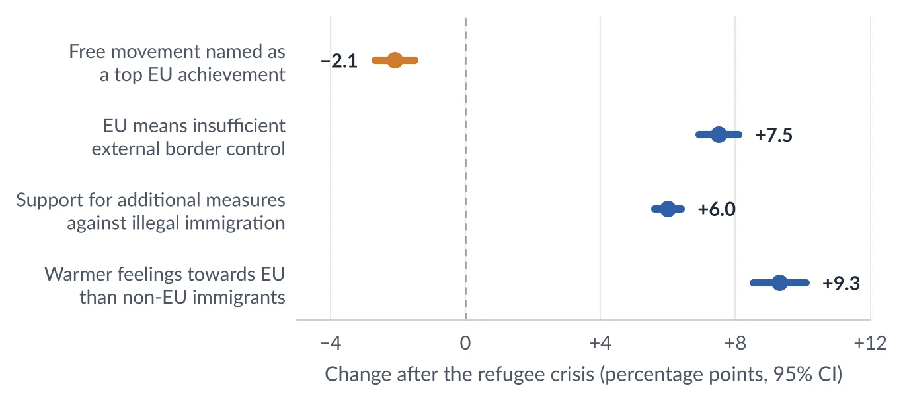</a><figcaption>Figure A6. Predicted bordering preferences by survey wave in countries directly affected and unaffected by the refugee crisis (online appendix). Redrawn from the published figure.</figcaption></figure>
  

- []{.ag data-ag="opinion sharing"} **Lutz, P.** (2021) Loved and feared: Citizens' ambivalence towards free movement in the European Union. *Journal of European Public Policy*, 28(2): 268–288.  
<i class="bi bi-award" aria-hidden="true"></i>ECSA Suisse Best Article Prize 2021
Many EU citizens are ambivalent about free movement: they value their own mobility and fear immigration from other member states.
[PDF](publications/Lutz2021_prepring.pdf){.pub-btn} · [DOI](https://doi.org/10.1080/13501763.2020.1720782){.pub-btn} · [Supplementary material](https://ndownloader.figstatic.com/files/21711534){.pub-btn} · [Blog post (EN)](https://ukandeu.ac.uk/brexit-and-public-support-for-free-movement/){.pub-btn} · [Blog post (DE)](https://nccr-onthemove.ch/blog/personenfreizugigkeit-in-der-krise/){.pub-btn}

    
Abstract

The right of citizens to live and work in any member state is a foundational pillar of the European Union. The views of EU citizens on free movement are characterized by a puzzle: the border-free Europe is seen as the most important achievement of European integration but also appears as a main driver of Euroscepticism. In this article, I argue that this is because of a tension between citizens’ own mobility rights and the mobility rights of citizens from other EU countries. This idea of ambivalence towards free movement is tested with observational data and a survey experiment across 28 EU countries. The results suggest that many citizens hold ambivalent views towards free movement due to a tension between the value of one’s own mobility and the fear of immigration. Their effective support depends on the relative salience of inward and outward mobility. This finding has important implications for the public support of international integration more generally. <figure class="pub-fig"><a class="fig-zoom" href="figures/lutz2021_prepring.webp">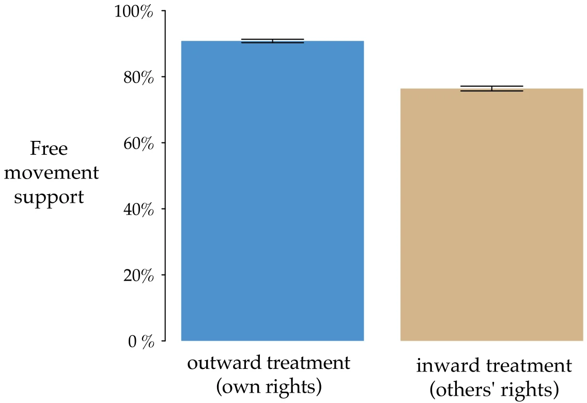</a><figcaption>Support for free movement by perspective-taking treatment (left) and by anti-immigration attitudes and the share of EU immigrants (right). Redrawn from Figures 2a and 1b of the preprint.</figcaption></figure>
  

- []{.ag data-ag="policy" data-pr="phd"} **Lutz, P.** (2021) Reassessing the gap-hypothesis: Tough talk and weak action in migration policy? *Party Politics*, 27(1): 174–186.  
Governing parties enact more liberal migration policies than their manifestos promise, and deliver on integration positions more than on immigration positions.
[DOI](https://doi.org/10.1177/1354068819840776){.pub-btn} 

    
Abstract

Much of the literature on migration policy has proclaimed a gap between what parties say and what parties do. The “gap-hypothesis” expects political parties to deliver “tough talk” and “weak action” on the issue of migration. This article tests this idea empirically by asking whether political parties keep their electoral promises on migration policy. The analysis of governments across 18 West European countries between 1980 and 2014 makes use of a new cabinet-based data set of migration policy outputs and two different data sets measuring parties’ preferences on migration. The results show that governing parties enact systematically more liberal policies on immigration and integration than their electoral manifestos would suggest. The purported democratic deficit in migration policy is substantially the result of a limited fulfillment of the electoral mandate by governing parties. Nevertheless, governing parties act upon their electoral mandate dependent on the governing constraints and the electoral incentives. Overall, governments tend to deliver on their integration policy positions but not on their immigration policy positions. The manifesto–policy link is stronger in the domestic policy dimension where governments face fewer external constraints. <figure class="pub-fig fig-narrow" style="max-width:660px"><a class="fig-zoom" href="figures/lutz2019_pp.webp">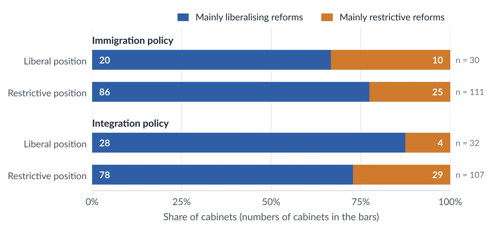</a><figcaption>Each cabinet coded by its manifesto position (CMP) and by whether its reforms were mainly liberalising or restrictive. Drawn from Table 1a.</figcaption></figure>
  

### 2020

- []{.ag data-ag="sharing"} **Lutz, P.**, Kaufmann, D., & Stünzi, A. (2020) Humanitarian protection as a European public good: The strategic role of states and refugees. *Journal of Common Market Studies*, 58(3): 757–775.  
States and refugees both benefit from a functioning European asylum system, yet each has few incentives to contribute to it.
[PDF](https://access.archive-ouverte.unige.ch/access/metadata/b700e179-1ce7-47ed-884b-f527f83aa2ba/download){.pub-btn} · [DOI](https://doi.org/10.1111/jcms.12974){.pub-btn} · [Supplementary material](publications/lutz_et_al2020_supplementary.pdf){.pub-btn} · [Blog post](https://jcms.ideasoneurope.eu/2020/02/27/why-european-asylum-policies-should-account-for-refugees-preferences/){.pub-btn}

    
Abstract

The surge of refugees arriving in Europe has accentuated the malfunctioning of the common European asylum system: the lack of coordination between nation states and failure in the common protection of refugees were the main outcomes of the so-called refugee crisis. This article builds on the literature on public goods and policy compliance in order to explain the failure of European countries to provide humanitarian protection to refugees. A sequential game-theoretical model serves to demonstrate the strategic interaction between states and refugees in European asylum policy. The analysis demonstrates that although both groups of actors benefit from a functioning European asylum system, they also have few incentives to contribute to the public good. States aim to reduce their individual refugee burden and refugees seek protection in their preferred destination country. The findings suggest that an effective provision of refugee protection requires both member states and refugees to contribute mutually to the public good.
  

- []{.ag data-ag="policy" data-pr="phd"} Armingeon, K. & **Lutz, P.** (2020) Muddling between responsiveness and responsibility: The Swiss case of a non-implementation of a constitutional rule. *Comparative European Politics*, 18(2): 256–280.  
Facing a dilemma between responsiveness and responsibility, politicians avoid a decision as long as possible, then opt for responsibility and shift the blame to external scapegoats.
[PDF](publications/Armingeon_Lutz_2020_preprint.pdf){.pub-btn} · [DOI](https://doi.org/10.1057/s41295-019-00185-2){.pub-btn} · [Supplementary material](publications/armingeon_lutz2020_supplementary.pdf){.pub-btn} 

    
Abstract

The tensions between responsible and responsive government have increased in the age of populism. How do politicians deal with this challenge? Do they give priority to short-term voter demands or are their strategies guided by the Weberian ethics of responsibility? We study this dilemma in the case of the Swiss popular vote establishing a constitutional amendment to cap immigration. This cap went against treaties with the European Union, which are of utmost economic importance to the Swiss people. We argue that politicians try to avoid a decision when facing a dilemma between responsibility and responsiveness to the people. If forced to take a stance, they may opt for responsibility, while shifting blame for being unresponsive to external scapegoats. Hence, politicians try to be responsive as long as possible before turning responsible and externalizing blame to minimize the electoral costs of non-responsiveness. This is a policy of muddling-through. Our findings bear important implications for representative democracy in times of external constraints. <figure class="pub-fig"><a class="fig-zoom" href="figures/armingeon_lutz_2020_preprint.webp">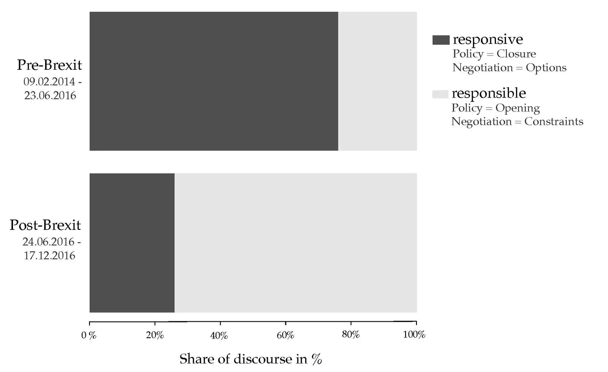</a><figcaption>Figure 5. Responsive and responsible discourse before and after Brexit.</figcaption></figure>
  

### 2019

- []{.ag data-ag="policy" data-pr="phd"} **Lutz, P.** (2019) Variation in policy success: Radical right populism and migration policy. *West European Politics*, 42(3): 517–544.  
Radical right parties shape immigrants' rights more than their numbers: in government, they restrict integration policies, while immigration policies have liberalised.
[PDF](publications/lutz2018.pdf){.pub-btn} · [DOI](https://doi.org/10.1080/01402382.2018.1504509){.pub-btn} · [Supplementary material](https://ndownloader.figstatic.com/files/13638401){.pub-btn}

    
Abstract

How do radical right populist parties influence government policies in their core issue of immigration? This article provides a systematic analysis of the direct and indirect effects of radical right anti-immigration parties on migration policy reforms in 17 West European countries from 1990 to 2014. Insights from migration policy theory serve to explain variations in the migration policy success of the radical right. While previous studies mostly treat migration policy as uniform, it is argued that this approach neglects the distinct political logics of immigration and integration policy. This article reveals significant variations in policy success by policy area. While immigration policies have become more liberal despite the electoral success of the radical right, when the radical right is in government office it enacts more restrictions in integration policies. Accordingly, anti-immigrant mobilisation is more likely to influence immigrants’ rights than their actual numbers. <figure class="pub-fig fig-narrow" style="max-width:660px"><a class="fig-zoom" href="figures/lutz2018.webp">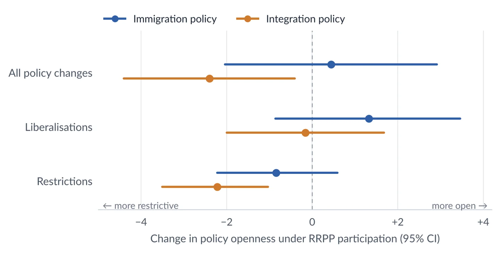</a><figcaption>Figure 1b. RRPP government participation and policy change (mainstream-right cabinets as reference). “All policy changes” from Table 2; liberalisations and restrictions redrawn from the published figure.</figcaption></figure>
  

### 2018

- Pleger, L., **Lutz, P.**, & Sager, F. (2018) Public acceptance of incentive-based spatial planning policies: A framing experiment. *Land Use Policy*, 73: 225–238.  
Policy frames can increase public acceptance of market-based spatial planning policies, with distinct effects for directly affected landowners.
[PDF](publications/pleger_et_al2018.pdf){.pub-btn} · [DOI](https://doi.org/10.1016/j.landusepol.2018.01.022){.pub-btn} · [Blog post (DE)](https://www.defacto.expert/2018/07/13/wie-ueber-raumplanungsinstrumente-kommuniziert-wird-kann-deren-akzeptanz-beeinflussen/){.pub-btn}

    
Abstract

Sustainable spatial planning strongly depends on efficient policy measures. A successful implementation of efficient policies, in turn, crucially depends on their public acceptance. This paper examines whether the way the public is provided with information on spatial planning policies influences public acceptance. Policy makers employ policy frames to influence voters. In a survey experiment among 644 Swiss participants we test goal framing and attribute framing effects by combining framing theory with a causal model for public policies. We show that policy frames can increase public acceptance of market-based spatial planning policies. Moreover, we find evidence that the framing effect differs for the target group of landowners and argue that their personal involvement makes them respond to specific frames. We conclude that the effects of policy frames on public acceptance crucially depend on personal involvement and that target group populations react to frames differently compared to a less directly affected population. <figure class="pub-fig fig-narrow" style="max-width:560px"><a class="fig-zoom" href="figures/pleger_et_al2018.webp">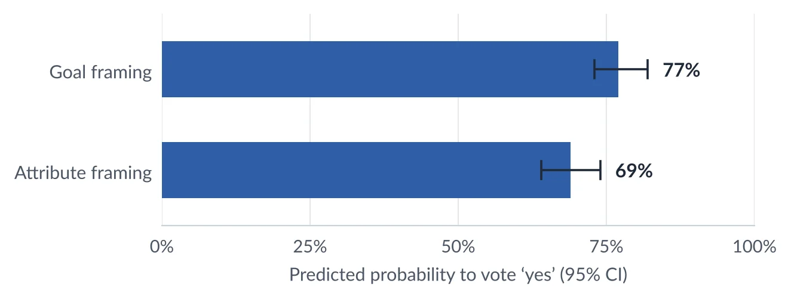</a><figcaption>Figure 2. Predicted Probabilities of Voting Decision by Framing Type. Redrawn from the values reported in the text.</figcaption></figure>
  

### 2017

- []{.ag data-ag="policy"} **Lutz, P.** (2017) Two logics of policy intervention in immigrant integration: An institutionalist framework based on capabilities and aspirations. *Comparative Migration Studies*, 5(1): 19.  
Assimilation works through incentives that raise immigrants' aspirations; multiculturalism works through opportunities that raise their capabilities.
[PDF](publications/lutz2017.pdf){.pub-btn} · [DOI](https://doi.org/10.1186/s40878-017-0064-0){.pub-btn} 

    
Abstract

The effectiveness of immigrant integration policies has gained considerable attention across Western democracies dealing with ethnically and culturally diverse societies. However, the findings on what type of policy produces more favourable integration outcomes remain inconclusive. The conflation of normative and analytical assumptions on integration is a major challenge for causal analysis of integration policies. This article applies actor-centered institutionalism as a new framework for the analysis of immigrant integration outcomes in order to separate two different mechanisms of policy intervention. Conceptualising integration outcomes as a function of capabilities and aspirations allows separating assumptions on the policy intervention in assimilation and multiculturalism as the two main types of policy approaches. The article illustrates that assimilation is an incentive-based policy and primarily designed to increase immigrants’ aspirations, whereas multiculturalism is an opportunity-based policy and primarily designed to increase immigrants’ capabilities. Conceptualising causal mechanisms of policy intervention clarifies the link between normative concepts of immigrant integration and analytical concepts of policy effectiveness. <figure class="pub-fig fig-narrow" style="max-width:600px"><a class="fig-zoom" href="figures/lutz2017.webp">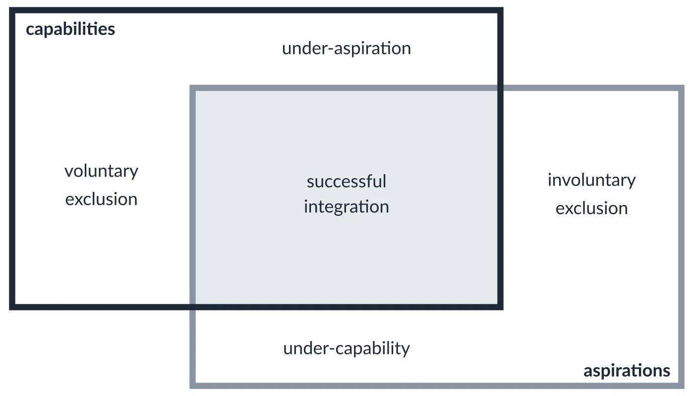</a><figcaption>Figure 1. Capability-Aspiration-Framework for Integration Outcomes.</figcaption></figure>
  

## PhD thesis

- []{.no-cites}[]{.cite data-key="Lutz2019inside"}[]{.ag data-ag="policy" data-pr="phd"} **Lutz, P.** (2019) *Inside the Migration State: The Quest for Democratic Legitimacy*. Doctoral dissertation, Institute of Political Science, University of Bern. DOI: 10.48549/4882  
Studying immigration policy-making from the perspective of democratic legitimacy, the thesis asks how liberal democracies reconcile the economic imperative for open borders with the political imperative for closed borders. The argument is that governments follow economic needs in admission policy, where their room for manoeuvre is narrow, and respond to political demands in integration policy, where they have more discretion. Across 18 West European democracies (1980–2014), admission policies became more liberal regardless of who governed, while integration policies became more restrictive and partisan. A case study of the 2014 Swiss referendum on immigration quotas shows the same logic: the clash with free movement was settled by strengthening the labour market integration of residents, a solution the public largely accepted.
Advisors: Prof. Klaus Armingeon (Bern) and Prof. Marc Helbling (Bamberg).  
[Full text](https://boris-portal.unibe.ch/entities/thesis/6b8c739d-ce3a-423d-9a3d-7bef42cf272e){.pub-btn} 

## Books

::: {.grid}

::: {.g-col-md-3}
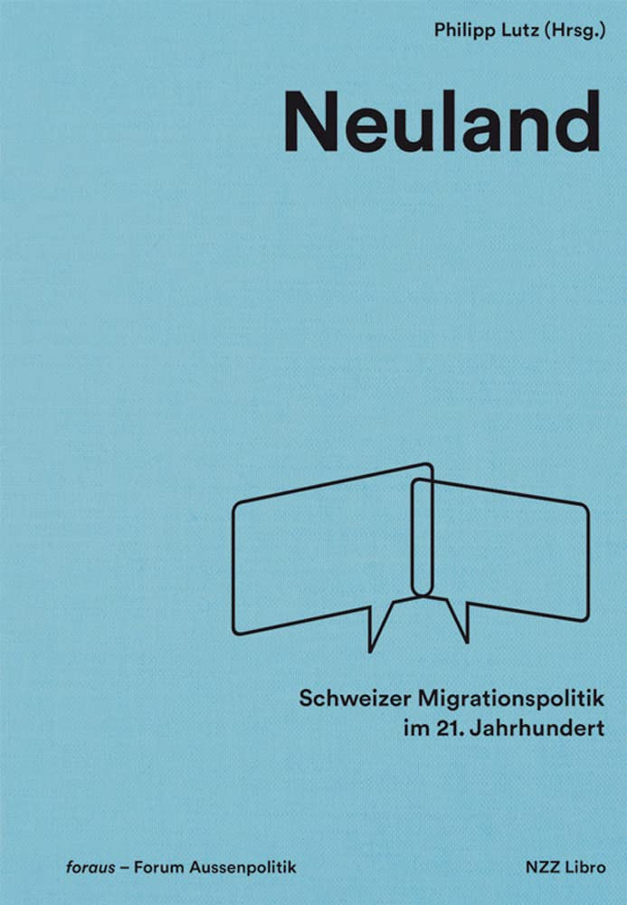{width=100% fig-alt="Cover of the book Neuland – Schweizer Migrationspolitik im 21. Jahrhundert"}
:::

::: {.g-col-md-9}
[]{.ag data-ag="policy"}**Lutz, P.** (Ed.) (2017) Neuland – Schweizer Migrationspolitik im 21. Jahrhundert. Zurich: NZZ Libro.

[Website publisher](https://www.nzz-libro.ch/produkt/neuland-9783038102991-t-13621){.pub-btn}  
  
Mit Beiträgen von Martina von Arx, Stefan Egli, Nicola Forster, David Kaufmann, Walter Leimgruber, Philipp Lutz, Joanna Menet, Jonas Nakonz, Johan Rochel, Seraina Rohner, Stefan Schlegel, Heike Scholten, Fabienne Tissot.  

Also available as E-Book.

    
Description

Die Schweiz ist ein Migrationsland, global vernetzt und mit einer erstaunlichen gesellschaftlichen Vielfalt. Diese Modernität hat noch nicht Eingang gefunden ins helvetische Selbstverständnis. Noch wird Migration als ein zu lösendesProblem betrachtet statt als Taktgeberin, die längst unseren Alltag bestimmt. Der Think-Tank foraus – Forum Aussenpolitik liefert ein komplett neues Narrativ für die Schweiz. Seine Vision für die Schweiz der Zukunft legt faktenreich dar, dass Migration kein Störfaktor der helvetischen Gemütlichkeit darstellt, sondern Ausdruck ist einer erfolgreichen Schweiz, die ihren Bewohnerinnen und Bewohnern einzigartige Freiheiten und Perspektiven ermöglicht. Die Publikation wird abgerundet mit konkreten migrationspolitischen Reformideen, mit denen die Schweiz ein chancenreiches Land wird, das sich nicht vor der Welt fürchtet.
  

:::

:::

## Book chapters (11)

- []{.cite data-key="Lutz2026warum"}[]{.ag data-ag="policy"} **Lutz, P.** (2026) Warum das Migrationsland Schweiz eine (neue) Erzählung braucht. In: Migrationsland Schweiz – Mythen, Realitäten und Perspektiven, herausgegeben durch Sanija Ameti, Lisa Mazzone, Nadja Mosimann, Cédric Wermuth, und Pascal Zwicky, Zürich, Verlag: edition 8, pp. 39-50.  
[PDF](publications/narrative.pdf){.pub-btn} · [Entire book](https://www.denknetz.ch/migration/){.pub-btn} · [Website publisher](https://www.denknetz.ch/migrationsland_schweiz/){.pub-btn} 

- []{.cite data-key="Lavenex2025mobility"}[]{.ag data-ag="trade" data-pr="mobilities"} Lavenex, S., Alvarado, M., Hoffmeyer-Zlotnik, P., & **Lutz, P.** (2025) Business mobility as a privileged form of temporary labour migration: Insights from the MITA database and Switzerland. In: Temporary labour migration: Towards social justice?, edited by Christiane Kuptsch and Fabiola Mieres. Geneva: International Labour Organisation, pp.107-128.  
[PDF](publications/ilo_chapter.pdf){.pub-btn} · [Entire book](https://www.ilo.org/sites/default/files/2025-02/Temporary%20labour%20migration%20-%20towards%20social%20justice.pdf){.pub-btn}

- []{.cite data-key="HoffmeyerZlotnik2024twolevel"}[]{.ag data-ag="trade" data-pr="mobilities"} Hoffmeyer-Zlotnik, P., Lavenex, S., & **Lutz, P.** (2024) Migration governance through trade agreements: A two-level analysis. In W. Sievers, R. Bauböck, M. Czaika, & A. Kraler (Eds.), *Drawing boundaries and crossing borders: Migration in Theorie und Praxis. Jahrbuch Migrationsforschung 7*. Vienna: Verlag der Österreichischen Akademie der Wissenschaften, pp. 169–184.  
[PDF](publications/mita_twolevel.pdf){.pub-btn} · [Entire book](https://www.researchgate.net/profile/Wiebke-Sievers/publication/388553825_Drawing_Boundaries_and_Crossing_Borders_Migration_in_Theorie_und_Praxis/links/679c9d6d52b58d39f25f37fa/Drawing-Boundaries-and-Crossing-Borders-Migration-in-Theorie-und-Praxis.pdf?origin=publicationDetail&_sg%5B0%5D=0QZkTzOhS3QmV0Grudh5FKyj2Vh3IUDP_tbVtb-Rm7A_qDu8x6FW49fV-rx3qSWTb2WOlz2HRsgAigGnsZNL2Q.5BetVE0vPIp73N7eh_mKM-9kaHd-nNSQUyQDfw-j3XStQb22tXwCDAuqtx0vPjr8ogaaUkd20DNjaY7JLR0AKw&_sg%5B1%5D=BBqhY54KPzCnjqinARQ9y5Q7tN02ufN3B_MksTLT8zQQVqFxHa33Zytr6V14f5TGwaETlqNCCiRrvBylbh0EPJ_OMydTL7C17s35c528yF8_.5BetVE0vPIp73N7eh_mKM-9kaHd-nNSQUyQDfw-j3XStQb22tXwCDAuqtx0vPjr8ogaaUkd20DNjaY7JLR0AKw&_iepl=&_rtd=eyJjb250ZW50SW50ZW50IjoibWFpbkl0ZW0ifQ%3D%3D&_tp=eyJjb250ZXh0Ijp7ImZpcnN0UGFnZSI6ImhvbWUiLCJwYWdlIjoicHVibGljYXRpb24iLCJwb3NpdGlvbiI6InBhZ2VIZWFkZXIifX0){.pub-btn}

- []{.cite data-key="Lutz2022legitimacy"}[]{.ag data-ag="opinion policy"} **Lutz, P.** & Knotz, C. (2022) The legitimacy of the welfare state in the age of migration. In B. Greve (Ed.), *De Gruyter Handbook of Contemporary Welfare States*. Berlin/Boston: De Gruyter, pp. 271–284.  
[PDF](publications/lutz_knotz2022.pdf){.pub-btn} · [Website publisher](https://www.degruyterbrill.com/document/doi/10.1515/9783110721768/html?srsltid=AfmBOorAwqiNJxXDqUcqgCdN-GAFkRiaVzmfCRiFsp9PLUKA79SaXYlj){.pub-btn}

- []{.cite data-key="Lavenex2022conflicts"}[]{.ag data-ag="policy sharing"} Lavenex, S., Hoffmeyer-Zlotnik, P., & **Lutz, P.** (2022) Migration: Conflicts between foreign and domestic policy. In T. Bernauer, K. Gentinetta, & J. Kuntz (Eds.), *A Swiss foreign policy for the 21st century*. Zurich: NZZ Libro, pp. 205–219.  
[PDF](publications/ch_foreign2021.pdf){.pub-btn} · [Website publisher](https://www.nzz-libro.ch/produkt/a-swiss-foreign-policy-for-the-21st-century-9783907291849-t-14074){.pub-btn}

- []{.cite data-key="Lavenex2021source"}[]{.ag data-ag="policy sharing" data-tr="1"} Lavenex, S., Hoffmeyer-Zlotnik, P., & **Lutz, P.** (2021) Migration: Une source de conflits entre les politiques extérieure et intérieure. In T. Bernauer, K. Gentinetta, & J. Kuntz (Eds.), *La politique extérieure suisse au défi du XXIe siècle*. Genève: Slatkine, pp. 185–198.  
[Website publisher](https://www.slatkine.com/fr/editions-slatkine/75232-book-07211088-9782832110881.html){.pub-btn}

- []{.cite data-key="Lavenex2021konflikt"}[]{.ag data-ag="policy sharing" data-tr="1"} Lavenex, S., Hoffmeyer-Zlotnik, P., & **Lutz, P.** (2021) Migration: Im Konflikt zwischen Aussen- und Innenpolitik. In T. Bernauer, K. Gentinetta, & J. Kuntz (Eds.), *Eine Aussenpolitik für die Schweiz im 21. Jahrhundert*. Zurich: NZZ Libro.  
[PDF](publications/ch_migration2021.pdf){.pub-btn} · [Website publisher](https://www.nzz-libro.ch/produkt/eine-aussenpolitik-fuer-die-schweiz-im-21-jahrhundert-9783907291580-t-14023){.pub-btn}

- []{.cite data-key="Lutz2020welfare"}[]{.ag data-ag="policy"} **Lutz, P.** (2020) Welfare states, demographic transition and immigration policies. In R. Careja, P. Emmenegger, & N. Giger (Eds.), *The European social model under pressure*. Springer, pp. 331–347.  
[PDF](publications/welfare2020.pdf){.pub-btn} · [Entire book](https://link.springer.com/content/pdf/10.1007/978-3-658-27043-8.pdf){.pub-btn} · [Website publisher](https://link.springer.com/book/10.1007/978-3-658-27043-8){.pub-btn}

    
Abstract

How does demographic change influence immigration policies in Western welfare
states? In this chapter, I discuss two perspectives on the relationship between demographic
ageing and labour immigration policies. Welfare states are under financial strain and face a
trade-off between too little immigration that could undermine their economic foundation and
too much immigration that could undermine their social foundation. Do welfare states admit
more foreign workers to sustain their welfare state model in the context of demographic ageing?
This contribution analyses the effects of population ageing on policy openness to immigration
and how welfare state regimes moderate this relationship. I examine these questions by
conducting a quantitative-comparative analysis of labour immigration policies in 21 Western
democracies between 1980 and 2010. The results reveal that the liberalisation of immigration
is a common response to demographic ageing but varies by welfare state regime. Social-
democratic welfare states face larger welfare risks from immigration and more difficulties to
integrate foreign labour. Instead of liberalising immigration, they opt for the facilitated
expansion of female employment. Only in the case of liberal and conservative welfare states is
there evidence for a demography-induced liberalisation of immigration. The findings suggest
that welfare state arrangements condition how countries respond to the demographic challenge
of an ageing population. <figure class="pub-fig fig-narrow" style="max-width:480px"><a class="fig-zoom" href="figures/welfare2020.webp">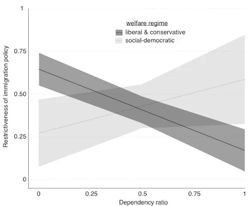</a><figcaption>Figure 2. Marginal effects plot of moderating effect by welfare state regimes (first panel).</figcaption></figure>
  

- []{.cite data-key="Lutz2019radical"}[]{.ag data-ag="policy" data-pr="phd"} **Lutz, P.** (2019) The Radical-Right in Power: A Comparative Analysis Of Their Migration Policy Influence. In: Biard, Benjamin/Bernhard, Laurent/Betz, Hans-Georg (Hrsg.): Do they make a difference? The policy influence of radical right populist parties in Western Europe. ECPR-Press.  
[PDF](publications/RRPP2019.pdf){.pub-btn} · [Website publisher](https://ecpr.eu/Shop/ShopProductInfo?productID=142){.pub-btn}

- []{.cite data-key="Sager2017politische"}Sager, F, Künzler, J. & **Lutz, P.** (2017) Das politische System der Schweiz und seine Kontaktpunkte zur Evaluation. In: Fritz, Sager, Thomas Widmer, Andreas Balthasar, Evaluation im politischen System der Schweiz Entwicklung, Bedeutung und Wechselwirkungen. Zürich: NZZ Libro.  
[PDF](publications/sager_et_al2017.pdf){.pub-btn} · [Website publisher](https://www.nzz-libro.ch/produkt/evaluation-im-politischen-system-der-schweiz-9783038103059-t-13624){.pub-btn}

- []{.cite data-key="Schlegel2016gebuehr"}[]{.ag data-ag="policy"} Schlegel, S, **Lutz, P.** & Kaufmann, D. (2016) Migration mit einer Gebühr schrittweise liberalisieren. In: Migrationsland Schweiz. Zürich: Hier und Jetzt Verlag.  
[PDF](publications/Migrationsland2016.pdf){.pub-btn} · [Website publisher](https://www.hierundjetzt.ch/de/catalogue/migrationsland-schweiz_16000004/){.pub-btn}

---

For outreach publications see [Engagement](engagement.qmd).

## Work in progress {#work-in-progress}

Papers under review (8)

- **Lutz, P.** Ignorant or biased? Immigration misperceptions as motivated social comparison.
- **Lutz, P.** Refugees welcome, but not here? NIMBYism and asylum attitudes.
- **Lutz, P.** (Mis-)perceptions of responsibility-sharing in European migration governance.
- **Lutz, P.**, & Schweinberger, T. How alliances shape refugee solidarity: Survey experiments in six European countries.
- **Lutz, P.**, Rausis, F., & Zaun, N. Strategic humanitarianism: Why states resettle refugees but deter asylum seekers.
- **Lutz, P.**, Lavenex, S., & Hoffmeyer-Zlotnik, P. The architecture of skilled migration governance in preferential trade agreements: Regionalism and beyond.
- Alvarado, M., Hoffmeyer-Zlotnik, P., Lavenex, S., & **Lutz, P.** Trading migrant rights? An analysis of migrant rights provisions in preferential trade agreements.
- Schmid, S., Rausis, F., Blatter, J., Portmann, L., & **Lutz, P.** Beyond the race to the bottom: How liberal and illiberal asylum policies diffuse across the globe.

<!--
To add a new paper, copy a block and edit. Format:

### YEAR

**Title of paper.**
Authors. *Journal*, volume(issue), pages.
[Link] · [PDF] · [Replication]

For multiple papers in a year, just add another block under the same year heading.

Research agenda tags: start each entry with []{.ag data-ag="..."} using one or more of
policy (comparative migration policies), opinion (public opinion and perceptions),
sharing (European governance and responsibility-sharing), trade (trade agreements).
Example: - []{.ag data-ag="trade policy"} **Lutz, P.** (2027) ...
The filter buttons and the publication counts on the homepage use these tags.
Translations of an entry get data-tr="1" as well, so the homepage counts them only once.
Work in progress: titles and co-authors only, no journals; when a paper is accepted, move it up to the journal articles.
-->
